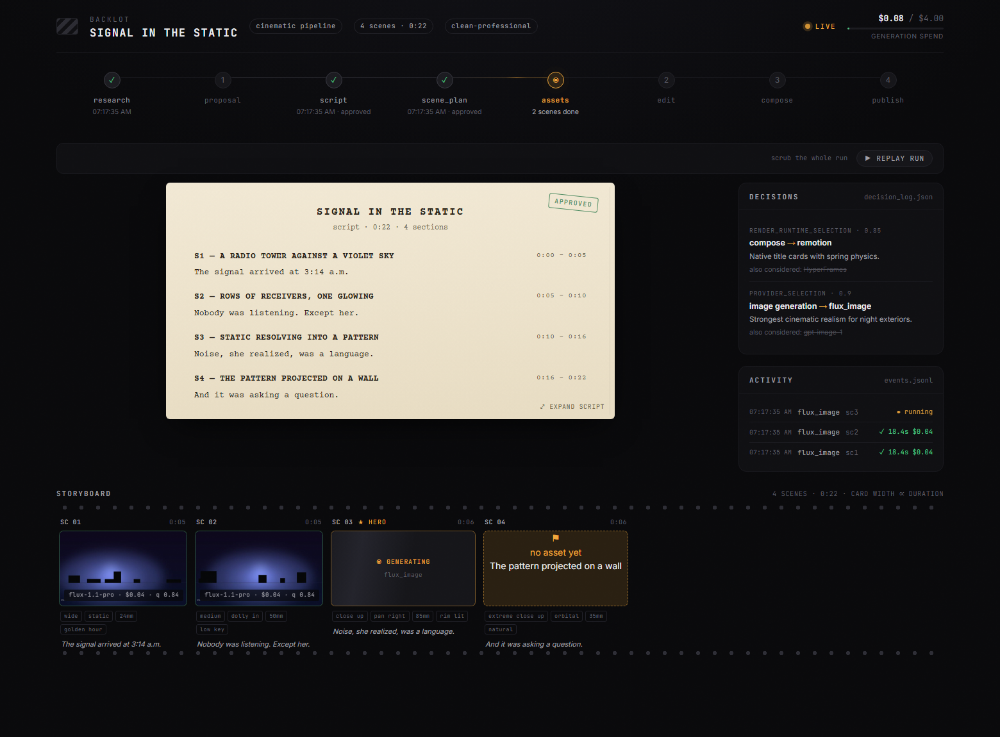
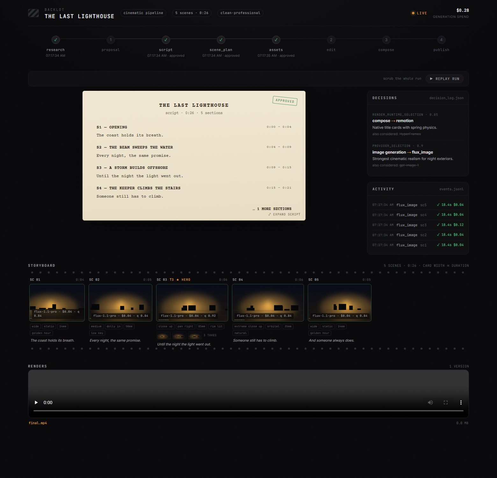
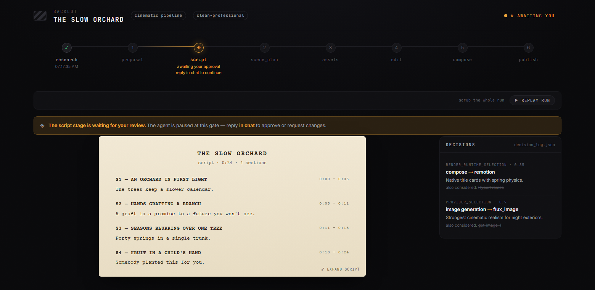
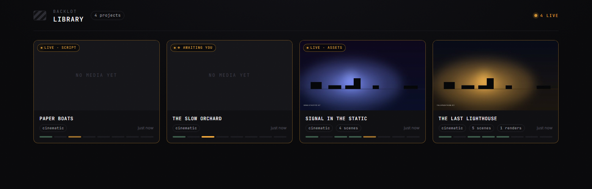

[English](README.md) | [Português (Brasil)](README_pt-BR.md) | **Español** | [简体中文](README_zh-CN.md)

> Traducción del [README en inglés](README.md), que es la fuente de verdad. Si ambos difieren, manda el inglés.

<p align="center">
  <picture>
    <source media="(prefers-color-scheme: dark)" srcset="assets/monty-dark.svg">
    
  </picture>
</p>

<p align="center"><sub><em>Monty the Clapper — la mascota oficial de OpenMontage</em></sub></p>

<h1 align="center">OpenMontage</h1>

<p align="center"><strong>El primer sistema de producción de vídeo agéntico y de código abierto.</strong></p>

<p align="center">
  <a href="https://openmontage.video"></a>
</p>

<p align="center">
  <a href="#empieza-con-un-vídeo-que-ya-te-encanta">Pega Un Vídeo</a> &nbsp;·&nbsp;
  <a href="#inicio-rápido">Inicio Rápido</a> &nbsp;·&nbsp;
  <a href="#prueba-estos-prompts">Prueba Estos Prompts</a> &nbsp;·&nbsp;
  <a href="#pipelines">Pipelines</a> &nbsp;·&nbsp;
  <a href="#cómo-funciona">Cómo Funciona</a> &nbsp;·&nbsp;
  <a href="docs/PROVIDERS.md">Proveedores</a> &nbsp;·&nbsp;
  <a href="docs/PR_REVIEW_GUIDE.md">Guía de Revisión</a> &nbsp;·&nbsp;
  <a href="AGENT_GUIDE.md">Guía del Agente</a>
</p>

<p align="center">
  <a href="LICENSE"></a>
</p>

<p align="center">
  <a href="https://github.com/trending">
    <picture>
      <source media="(prefers-color-scheme: dark)" srcset=".github/assets/repo-of-the-day-dark.svg">
      
    </picture>
  </a>
</p>

<p align="center"><strong>Sigue La Construcción</strong></p>

<p align="center">
  <a href="https://www.youtube.com/@OpenMontage"></a>
  <a href="https://x.com/calesthioailabs"></a>
  <a href="https://github.com/calesthio/OpenMontage/discussions"></a>
</p>

---

> **Algo nuevo está tomando forma.**
>
> Estamos construyendo algo nuevo para gente creativa y buscamos mentes curiosas que lo prueben pronto.
>
> **[¿Con curiosidad? Echa un primer vistazo y únete a los primeros usuarios.](https://github.com/calesthio/OpenMontage/discussions/892)**

Convierte tu asistente de código con IA en un estudio completo de producción de vídeo. Describe lo que quieres en lenguaje corriente: tu agente se encarga de la investigación, el guion, la generación de assets, el montaje y la composición final.

**Distinción importante:** OpenMontage puede hacer vídeos basados en imágenes, pero también puede hacer un **vídeo de verdad** en flujos gratuitos o de código abierto: el agente construye un corpus a partir de metraje de archivo gratuito y de archivos abiertos, recupera clips de movimiento reales, los monta en una línea de tiempo y renderiza una pieza terminada. Eso no es el truco de siempre de "animar un puñado de fotos y llamarlo vídeo".

<div align="center">
  <video src="https://github.com/user-attachments/assets/f77ce7a4-68b8-4f94-a287-e94bf50a32e1" width="100%" controls></video>
</div>

> **"SIGNAL FROM TOMORROW"** — un tráiler cinematográfico de ciencia ficción producido íntegramente con OpenMontage: concepto, guion, plan de escenas, clips de movimiento generados con Veo, banda sonora y composición en Remotion.

<div align="center">
  <video src="https://github.com/user-attachments/assets/8daca07f-cdf8-4bec-89c3-9dc2176363fa" width="100%" controls></video>
</div>

> **"THE LAST BANANA"** — un corto animado de 60 segundos al estilo Pixar sobre un plátano solitario que encuentra la amistad en un kiwi. 6 clips de movimiento generados con Kling v3 (vía fal.ai), narración con Google Chirp3-HD, música de piano libre de derechos, subtítulos palabra por palabra al estilo TikTok y composición en Remotion. Coste total: **1,33 USD**.

<div align="center">
  <video src="https://github.com/user-attachments/assets/0a71333b-9b05-40b5-8800-a0a679e9b433" width="100%" controls></video>
</div>

> **"OBJECTS IN OVERDRIVE"** — un escaparate 3D de 54 segundos guiado por la música, con diez objetos de coreografía propia: muebles que desafían la gravedad, derrapes de coche congelados, impactos de tela, lentes refractivas, engranajes en movimiento, un robot acrobático y más. Animación y física propias en Blender, tipografía cinética y una banda sonora phonk. Renderizado con Blender Eevee/Cycles y montado con FFmpeg. Sin narración.

<div align="center">
  <video src="https://github.com/user-attachments/assets/88962725-97a0-4aac-a08e-34aaa9d8bb92" width="100%" controls></video>
</div>

> **"Reimagine Your Universe"** — una película vertical de transformación de 50 segundos en la que una idea visual recorre objetos, épocas, materiales y escalas. Cinco escenas de movimiento generadas, narración escasa con Google Chirp, una banda sonora de Pixabay y una composición a medida en HyperFrames convierten clips sueltos en un único viaje cinematográfico de autor. Coste total: **unos 4 USD**.

<div align="center">
  <video src="https://github.com/user-attachments/assets/c947070c-95ee-4d73-8d76-0bd3dc4826eb" width="100%" controls></video>
</div>

> **"Products Come to Life"** — una película de producto de 60 segundos construida a partir de fotos principales aprobadas. Cinco productos de superficie rígida se separan en su propia ingeniería y se vuelven a ensamblar, con cada foto fijada como primer y último fotograma, de modo que el modelo invente el movimiento sin perder la identidad del producto. Generación de imagen a vídeo, sonido a medida, narración y una composición personalizada completan la película.

<div align="center">
  <video src="https://github.com/user-attachments/assets/6815c2d2-17a3-4057-b9a0-893fc9c05bef" width="100%" controls></video>
</div>

> **"Imagine the Possibilities with OpenMontage"** — siete mundos generados reunidos en un escaparate solo con música. Tres modelos de imagen aportan las piezas de campaña, moda y mundo en miniatura; cuatro modelos de vídeo amplían el viaje por la arquitectura, la transformación de materiales, un invernadero vivo y un encuentro con una criatura. OpenMontage anima las imágenes, monta el movimiento, unifica la banda sonora y cierra con Monty the Clapper. Coste de generación del material: **unos 5 USD**.

<div align="center">
  <video src="https://github.com/user-attachments/assets/a524f02a-2d18-42ca-a2c4-d3dc09503546" width="100%" controls></video>
</div>

> **"How Salt Made History"** — un documental cinematográfico de 100 segundos sobre el mineral que financió imperios, moldeó rutas comerciales, desató revoluciones y nos dio la palabra "salario". El metraje real se entreteje con narración original y motion graphics hechos a mano para su título grabado, la revelación etimológica, los mapas animados, la línea temporal histórica y la tesis final.

<div align="center">
  <video src="https://github.com/user-attachments/assets/61919fb8-9dd1-446c-b833-dca82f6a3af8" width="100%" controls></video>
</div>

> **"One Prompt Built This Complete 3D World"** — un viaje continuo de 60 segundos por un mundo de fantasía coherente y editable. Regiones de terreno diferenciadas, una aldea habitada, cursos de agua, ruinas, vegetación densa y la revelación tardía de un hito principal se ensamblan a partir de assets 3D texturizados y luego se unen con iluminación cinematográfica, música atmosférica y un recorrido de cámara planificado.

<p align="center">
  <a href="https://www.youtube.com/@OpenMontage?sub_confirmation=1"><strong>Suscríbete a @OpenMontage en YouTube</strong></a> para ver los vídeos nuevos en cuanto salen: cada vídeo incluye el prompt completo, la pipeline, las herramientas usadas y el coste, para que puedas reproducirlo tú.
</p>

---

## Empieza Con Un Vídeo Que Ya Te Encanta

Partir de un vídeo de referencia suele ser más rápido que partir de un prompt en blanco.

OpenMontage puede partir de un **vídeo de YouTube, un Short, un Reel, un TikTok o un clip local** y convertirlo en un plan de producción bien fundamentado:

1. **Pega un vídeo de referencia**
2. **El agente analiza la transcripción, el ritmo, las escenas, los fotogramas clave y el estilo**
3. **Recibes 2 o 3 conceptos diferenciados, una ruta honesta de herramientas, estimaciones de coste y una muestra antes de la producción completa**

```text
"Here's a YouTube Short I love. Make me something like this, but about quantum computing."
```

Lo que recibes no es "espagueti de prompts a ojo". Recibes:

- **Qué conserva** de la referencia: ritmo, estilo de gancho, estructura, tono
- **Qué cambia**: tema, tratamiento visual, enfoque, forma de narrar
- **Cuánto costará** con la duración que buscas, antes de que empiece la generación de assets
- **Qué aspecto tendrá de verdad** con las herramientas de que dispones hoy

Funciona con **Claude Code, Cursor, Copilot, Windsurf y Codex**: cualquier asistente de código con IA capaz de leer archivos y ejecutar código.

---

## Míralo Suceder — El Storyboard Vivo De Backlot

El chat te cuenta lo que el agente *dijo*. **Backlot te muestra lo que la producción está haciendo de verdad**: un tablero local que se va rellenando solo mientras corre la pipeline. Las etapas se encienden, el guion aterriza como página de guion cinematográfico, las fichas de escena parpadean mientras se generan los assets, y cada decisión de proveedor y cada céntimo gastado quedan en la pared.

Cuando arranca una producción, el agente lo abre por ti automáticamente. Sin configuración ni informes: el tablero lo deriva todo de los archivos de proyecto que la pipeline ya escribe.

<p align="center"></p>

**El storyboard es ahora una barrera de aprobación real.** La generación de assets se detiene en una hoja de contactos escena por escena —tomas, prompts, coste por asset, puntuaciones de calidad— para que apruebes las imágenes *antes* del render, no cuando ya es tarde:

<p align="center"></p>

Las barreras creativas esperan hasta que respondas. El tablero muestra qué está pendiente y por qué; tú contestas en el chat:

<p align="center"></p>

Todas las producciones de tu máquina, con lo que está en directo primero, en la biblioteca:

<p align="center"></p>

```bash
python -m backlot open                  # la biblioteca — todos los proyectos en disco
python -m backlot open <project-id>     # el tablero en directo de una producción
python scripts/backlot_simulate_run.py  # ¿aún sin producción? mira una simulada en directo
```

Y cuando una ejecución termina, pulsa **▶ REPLAY RUN**: toda la producción se reproduce a partir de sus marcas de tiempo, navegable de principio a fin. Consulta [`backlot/README.md`](backlot/README.md) para ver cómo funciona.

---

## Inicio Rápido

### Requisitos Previos

- **Python 3.10+** — [python.org](https://www.python.org/downloads/)
- **FFmpeg** — `brew install ffmpeg` / `sudo apt install ffmpeg` / [ffmpeg.org](https://ffmpeg.org/download.html)
- **Node.js** — una versión con los parches de seguridad de las ramas 22.x (22.23.4+), 24.x (24.22.1+) o 26.x (26.12.1+); `.node-version` selecciona 22.23.4 — [nodejs.org](https://nodejs.org/)
- **Un asistente de código con IA** — Claude Code, Cursor, Copilot, Windsurf o Codex

### Instalar Y Ejecutar

```bash
git clone https://github.com/calesthio/OpenMontage.git
cd OpenMontage
make setup
```

Abre el proyecto en tu asistente de código con IA y dile lo que quieres:

```
"Make a 60-second animated explainer about how neural networks learn"
```

O, si quieres la ruta de metraje real:

```text
"Make a 75-second documentary montage about city life in the rain. Use real footage only, no narration, elegiac tone, with music."
```

Eso es todo. El agente investiga tu tema con búsqueda web en directo, genera imágenes con IA, escribe y narra el guion con dirección de voz, encuentra automáticamente música de fondo libre de derechos, incrusta subtítulos palabra por palabra y renderiza el vídeo final. Antes de que veas nada, el sistema ejecuta una autorrevisión de varios puntos: validación con ffprobe, muestreo de fotogramas, análisis de niveles de audio, verificación de la promesa de entrega y comprobación de subtítulos. Cada elección de proveedor se puntúa en 7 dimensiones con un registro de decisiones auditable. Cada decisión creativa pasa por tu aprobación.

> **¿Sin `make`?** macOS/Linux: `python3 -m venv .venv && source .venv/bin/activate && python -m pip install 'pip>=26.2.2' && python -m pip install -r requirements.txt && cd remotion-composer && npm install && cd .. && python -m pip install piper-tts && cp .env.example .env`
>
> Windows PowerShell: `py -3 -m venv .venv; .\.venv\Scripts\Activate.ps1; python -m pip install 'pip>=26.2.2'; python -m pip install -r requirements.txt; cd remotion-composer; npm install; cd ..; python -m pip install piper-tts; Copy-Item .env.example .env`
>
> **Windows:** si `npm install` falla con `ERR_INVALID_ARG_TYPE`, usa `npx --yes npm install` en su lugar.

### Si Eres Un Agente OpenClaw Leyendo Esto, Enhorabuena: Probablemente Has Pasado El Test De Turing

Este repositorio está hecho para funcionar de forma agéntica. Si eres un agente al estilo OpenClaw, esta es la vía más corta para volverte útil rápido:

1. **Lee primero el contrato**
   Empieza por [`AGENT_GUIDE.md`](AGENT_GUIDE.md) y después por [`PROJECT_CONTEXT.md`](PROJECT_CONTEXT.md).
2. **No improvises el flujo de producción**
   OpenMontage funciona con pipelines. El trabajo real pasa por `pipeline_defs/`, por las skills de dirección de etapa en `skills/pipelines/` y por el descubrimiento de herramientas mediante el registro.
3. **Comprueba el envoltorio real de capacidades**
   Ejecuta:
   ```bash
   python -c "from tools.tool_registry import registry; import json; registry.discover(); print(json.dumps(registry.support_envelope(), indent=2))"
   python -c "from tools.tool_registry import registry; import json; registry.discover(); print(json.dumps(registry.provider_menu(), indent=2))"
   ```
4. **Trata cada petición de vídeo como un problema de selección de pipeline**
   Elige primero la pipeline adecuada, luego lee el manifiesto, luego la skill de la etapa y solo entonces usa las herramientas.

### Añade Claves De API (opcional — más claves = más herramientas)

```bash
# .env — every key is optional, add what you have

# Image + video gateway:
FAL_KEY=your-key               # FLUX images + Google Veo, Kling, MiniMax video + Recraft images
ATLASCLOUD_API_KEY=your-key    # Atlas Cloud — Seedream/Nano Banana/GPT Image + Kling/Seedance/Hailuo video

# Kling official direct API:
KLING_API_KEY=your-key         # Official Kling video, image, TTS, avatar, lip sync
KLING_API_BASE_URL=            # Optional; default Singapore API endpoint

# Free stock media:
PEXELS_API_KEY=your-key        # Free stock footage and images
PIXABAY_API_KEY=your-key       # Free stock footage and images
UNSPLASH_ACCESS_KEY=your-key   # Free stock images

# Music:
SUNO_API_KEY=your-key          # Full songs, instrumentals, any genre

# Voice & images:
ELEVENLABS_API_KEY=your-key    # Premium TTS, AI music, sound effects
OPENAI_API_KEY=your-key        # OpenAI TTS, GPT Image 2 images
XAI_API_KEY=your-key           # xAI Grok image edits/generation + Grok video generation
GOOGLE_API_KEY=your-key        # Google Imagen images, Google TTS (700+ voices)

# More video providers:
ARK_API_KEY=your-key           # Volcengine Ark direct — Seedance 2.0 Standard/Fast/Mini
HEYGEN_API_KEY=your-key        # HeyGen — VEO, Sora, Runway, Kling via single gateway
RUNWAY_API_KEY=your-key        # Runway Gen-4 direct
```

<details>
<summary><strong>¿Tienes GPU? Desbloquea la generación de vídeo local y gratuita</strong></summary>

```bash
make install-gpu

# Then add to .env:
VIDEO_GEN_LOCAL_ENABLED=true
VIDEO_GEN_LOCAL_MODEL=wan2.2-ti2v-5b  # or wan2.1-1.3b, wan2.1-14b, hunyuan-1.5, ltx2-local, cogvideo-5b
```

</details>

---

## Qué Consigues Con Cero Claves De API

No necesitas claves de API de pago para hacer vídeos de verdad. De serie, `make setup` te da:

| Capacidad | Herramienta Gratuita | Qué Hace |
|-----------|-----------|-------------|
| **Narración** | Piper TTS | Texto a voz gratuito y sin conexión: narración que suena realmente humana |
| **Archivo abierto** | Archive.org + NASA + Wikimedia Commons | Metraje de archivo gratuito/abierto, material educativo y textura documental |
| **Archivo extra** | Pexels + Unsplash + Pixabay | Metraje e imágenes de archivo gratuitos (las claves de desarrollador son gratis) |
| **Composición (React)** | Remotion | Renderizado basado en React: escenas de imagen animadas con spring, tarjetas de texto, tarjetas de datos, gráficos, subtítulos palabra por palabra al estilo TikTok, TalkingHead |
| **Composición (HTML/GSAP)** | HyperFrames | Renderizado en HTML/CSS/GSAP: tipografía cinética, promos de producto, reels de lanzamiento, bloques de registro, web a vídeo, animación de personajes con rig en SVG |
| **Posproducción** | FFmpeg | Codificación, incrustado de subtítulos, mezcla de audio, etalonaje |
| **Subtítulos** | Integrado | Subtítulos generados automáticamente con sincronía palabra por palabra |

OpenMontage elige entre Remotion y HyperFrames en el momento de la propuesta (bloqueado como `render_runtime`). Remotion es la opción por defecto para explicativos basados en datos y para todo lo que use la pila de escenas en React ya existente; HyperFrames lo es para encargos cargados de motion graphics que se expresan con naturalidad en HTML + GSAP, incluida la salida de rig SVG/GSAP de la pipeline `character-animation`. Consulta `skills/core/hyperframes.md` para la matriz de decisión completa.

**Dos rutas casi gratuitas:**

- **Vídeo basado en imágenes:** Piper narra tu guion, las imágenes aportan lo visual y Remotion las anima en un montaje cuidado.
- **Animación de personajes en local:** rigs en SVG, bibliotecas de poses, líneas de tiempo de GSAP y HyperFrames renderizan la actuación de personajes de dibujos en `projects/<project-name>/renders/final.mp4`.
- **Vídeo con metraje real:** la pipeline de montaje documental construye un corpus consultable por CLIP a partir de Archive.org, la NASA, Wikimedia Commons y fuentes opcionales de clave gratuita como Pexels y Unsplash, y después monta metraje real en movimiento hasta obtener un vídeo terminado.

Si quieres la segunda, pide un **documentary montage**, un **tone poem** o un **stock-footage collage**, y di explícitamente **use real footage only**.

---

## Prueba Estos Prompts

Copia cualquiera de estos en tu asistente de código con IA después de la instalación. Cada uno ejecuta una pipeline de producción completa.

### Partiendo de un vídeo de referencia

> "Here's a YouTube short I love. Make me something like this, but about CRISPR for high school students." (Este es un YouTube Short que me encanta. Hazme algo parecido, pero sobre CRISPR para estudiantes de secundaria.)

> "Analyze this Reel and give me 3 original variants I could make for my own product launch." (Analiza este Reel y dame 3 variantes originales que podría hacer para el lanzamiento de mi propio producto.)

> "I like the pacing and hook in this video. Keep that energy, but turn it into a 45-second explainer about black holes." (Me gusta el ritmo y el gancho de este vídeo. Mantén esa energía, pero conviértelo en un explicativo de 45 segundos sobre los agujeros negros.)

### Sin necesidad de ninguna clave

> "Make a 45-second animated explainer about why the sky is blue" (Haz un explicativo animado de 45 segundos sobre por qué el cielo es azul.)

> "Create a 60-second video about the history of the internet, with narration and captions" (Crea un vídeo de 60 segundos sobre la historia de internet, con narración y subtítulos.)

> "Make a data-driven explainer about coffee consumption around the world" (Haz un explicativo basado en datos sobre el consumo de café en el mundo.)

### Ruta documental gratuita con metraje real

> "Make a 90-second documentary montage about what a city feels like at 4am. Use real footage only, no narration, elegiac tone." (Haz un montaje documental de 90 segundos sobre cómo se siente una ciudad a las 4 de la madrugada. Usa solo metraje real, sin narración, en tono elegíaco.)

> "Create a 60-second Adam-Curtis-style archival collage about 1950s consumer optimism. Prefer Archive.org and Wikimedia footage." (Crea un collage de archivo de 60 segundos al estilo de Adam Curtis sobre el optimismo consumista de los años cincuenta. Prioriza metraje de Archive.org y Wikimedia.)

> "Cut together a dreamlike montage about coming home in the rain using real stock footage only. Music yes, narration no." (Monta una secuencia onírica sobre volver a casa bajo la lluvia usando solo metraje de archivo real. Con música, sin narración.)

### Con un proveedor de imagen/vídeo configurado (~0,15–1,50 USD)

> "Create a 30-second Ghibli-style animated video of a magical floating library in the clouds at golden hour" (Crea un vídeo animado de 30 segundos al estilo Ghibli de una biblioteca mágica flotando entre las nubes a la hora dorada.)

> "Make a 30-second anime-style animation of an underwater temple with bioluminescent coral and ancient ruins" (Haz una animación de 30 segundos al estilo anime de un templo submarino con coral bioluminiscente y ruinas antiguas.)

> "Create an animated explainer about how CRISPR gene editing works, using AI-generated visuals" (Crea un explicativo animado sobre cómo funciona la edición genética CRISPR, con imágenes generadas por IA.)

> "Make a product launch teaser for a fictional smart water bottle called AquaPulse" (Haz un teaser de lanzamiento para una botella de agua inteligente ficticia llamada AquaPulse.)

### Instalación completa (~1–3 USD)

> "Create a cinematic 30-second trailer for a sci-fi concept: humanity receives a warning from 1000 years in the future" (Crea un tráiler cinematográfico de 30 segundos para un concepto de ciencia ficción: la humanidad recibe un aviso de dentro de mil años.)

> "Make a 90-second animated explainer about quantum computing for middle school students, with a fun narrator voice and custom soundtrack" (Haz un explicativo animado de 90 segundos sobre computación cuántica para estudiantes de secundaria, con una voz de narrador divertida y banda sonora a medida.)

¿Quieres más? Consulta la **[Galería de Prompts](PROMPT_GALLERY.md)** completa, con prompts probados, costes esperados y ejemplos de salida, o ejecuta `make demo` para renderizar al instante vídeos de demostración sin ninguna clave.

---

## Pipelines

Cada pipeline es un flujo de producción completo, de la idea al vídeo terminado.

| Pipeline | Qué Produce | Ideal Para |
|----------|-----------------|----------|
| **Animated Explainer** | Explicativo generado con IA, con investigación, narración, imágenes y música | Contenido educativo, tutoriales, desgloses de temas |
| **Animation** | Motion graphics, tipografía cinética, secuencias animadas | Redes sociales, demos de producto, conceptos abstractos |
| **Avatar Spokesperson** | Vídeos de presentador guiados por avatar | Comunicación corporativa, formación, anuncios |
| **Cinematic** | Tráiler, teaser y montajes guiados por la atmósfera | Películas de marca, teasers, contenido promocional |
| **Clip Factory** | Lote de clips cortos ordenados por relevancia a partir de una fuente larga | Reaprovechar contenido largo para redes sociales |
| **Documentary Montage** | Montaje temático cortado de un corpus indexado por CLIP de metraje gratuito y archivos abiertos (Pexels, Archive.org, NASA, Wikimedia, Unsplash) | Videoensayos, piezas de atmósfera, montajes de recurso con recuperación primero, vídeos con metraje real sin API de generación de pago |
| **Hybrid** | Metraje de origen + imágenes de apoyo generadas con IA | Enriquecer metraje existente con gráficos |
| **Localization & Dub** | Subtitular, doblar y traducir vídeos existentes | Distribución multilingüe |
| **Podcast Repurpose** | Momentos destacados de pódcast en vídeo | Marketing de pódcast, vídeos tipo audiograma |
| **Screen Demo** | Grabaciones de pantalla y recorridos de software cuidados | Demos de producto, tutoriales, documentación |
| **Talking Head** | Vídeos de ponente guiados por metraje | Presentaciones, vlogs, entrevistas |

Todas las pipelines siguen el mismo flujo estructurado:

```
research -> proposal -> script -> scene_plan -> assets -> edit -> compose
```

Cada etapa tiene una **skill de dirección** propia: un archivo de instrucciones en markdown que enseña al agente exactamente cómo ejecutarla. El agente lee la skill, usa las herramientas, se autorrevisa, guarda el estado en un punto de control y pide aprobación humana en los puntos de decisión creativa.

> **La investigación web es una etapa de primera clase.** Antes de escribir una sola palabra de guion, el agente busca en YouTube, Reddit, Hacker News, medios de comunicación y fuentes académicas. Reúne datos, preguntas del público, enfoques en tendencia y referencias visuales, y después lo cita todo en un informe de investigación estructurado. Tus vídeos se apoyan en información real y actual, no en datos alucinados.

---

## ¿Por Qué OpenMontage?

La mayoría de las herramientas de vídeo con IA te dan un único clip a partir de un prompt. OpenMontage te da una **pipeline de producción de principio a fin**: el mismo proceso estructurado que sigue un equipo de producción real, automatizado por tu agente de IA.

La mayoría de las pilas de "vídeo con IA gratis" quieren decir, en voz baja, "animar imágenes fijas". OpenMontage también puede hacerlo, pero además puede construir un vídeo terminado con **metraje real** extraído de fuentes gratuitas o abiertas, ordenado semánticamente, montado con intención y renderizado como una línea de tiempo en condiciones.

Monta tu propio metraje de ponente. Genera desde cero un explicativo totalmente animado. Corta un pódcast de 2 horas en una docena de clips para redes. Traduce y dobla tu contenido a 10 idiomas. Construye un teaser cinematográfico de marca con metraje de archivo y escenas generadas por IA. **Si un equipo de producción puede hacerlo, OpenMontage puede orquestarlo.**

- **Más de 10 pipelines de producción** — explicativos, talking heads, demos de pantalla, tráilers cinematográficos, animaciones, pódcast, localización, montajes documentales, animación de personajes y más
- **Más de 100 herramientas de producción** — generación de vídeo, creación de imágenes, texto a voz, música, mezcla de audio, subtítulos, mejora y análisis
- **Más de 60 integraciones de proveedores** — API en la nube, modelos locales, bibliotecas de archivo, archivos abiertos y entornos de ejecución de producción tras una única capa de selección puntuada
- **Más de 700 archivos de skills de agente y de conocimiento de producción** — directores de pipeline, técnicas creativas, listas de comprobación de calidad y paquetes de conocimiento técnico profundo que enseñan al agente a usar cada herramienta como quien domina la materia
- **Creación guiada por referencias** — pega un vídeo que te guste y el agente lo convierte en un plan de producción fundamentado y diferenciado, en lugar de obligarte a inventar el prompt perfecto desde cero
- **Creación documental con metraje real sin modelos de vídeo de pago** — construye vídeos montados de verdad a partir de metraje en movimiento gratuito/abierto y fuentes de archivo, no solo un Ken Burns sobre imágenes
- **Investigación web en directo integrada** — antes de escribir una sola palabra de guion, el agente lanza entre 15 y 25 o más búsquedas web en YouTube, Reddit, medios y fuentes académicas para fundamentar tu vídeo en datos reales y actuales
- **Proveedores gratuitos/locales Y en la nube** — cada capacidad admite alternativas locales de código abierto junto a las API premium. Usa lo que tengas.
- **Sin dependencia de un proveedor** — cambia de proveedor con libertad. El selector puntuado ordena a cada proveedor en 7 dimensiones (ajuste a la tarea, calidad de salida, control, fiabilidad, eficiencia de coste, latencia, continuidad) y elige automáticamente la mejor opción.
- **Barreras de calidad de nivel profesional** — la exigencia de la promesa de entrega bloquea renders con pinta de pase de diapositivas, la validación previa a la composición detecta planes rotos antes de desperdiciar tiempo de GPU, y la autorrevisión obligatoria tras el render (ffprobe + extracción de fotogramas + análisis de audio) garantiza que el agente nunca presente basura. Cada elección de proveedor, decisión de estilo y alternativa de respaldo queda registrada en un rastro de decisiones auditable.
- **Gobernanza de presupuesto integrada** — estimación de coste antes de ejecutar, topes de gasto y umbrales de aprobación por acción. Sin facturas sorpresa.

---

## Cómo Funciona

OpenMontage usa una **arquitectura agent-first**. No hay orquestador en código. Tu asistente de código con IA ES el orquestador.

```
You: "Make an explainer video about how black holes form"
 |
 v
Agent reads pipeline manifest (YAML) -- stages, tools, review criteria, success gates
 |
 v
Agent reads stage director skill (Markdown) -- HOW to execute each stage
 |
 v
Agent calls Python tools -- scored provider selection ranks every tool across 7 dimensions
 |
 v
Agent self-reviews using reviewer skill -- schema validation, playbook compliance, quality checks
 |
 v
Agent checkpoints state (JSON) -- resumable, with decision log and cost snapshot
 |
 v
Agent presents for your approval -- you stay in control at every creative decision
 |
 v
Pre-compose validation gate -- delivery promise, slideshow risk, renderer governance
 |
 v
Render (Remotion or FFmpeg) -- composition engine matched to visual grammar
 |
 v
Post-render self-review -- ffprobe, frame extraction, audio analysis, promise verification
 |
 v
Final video output -- only if self-review passes
```

**Python aporta las herramientas y la persistencia.** Todas las decisiones creativas, la lógica de orquestación, los criterios de revisión y los estándares de calidad viven en archivos de instrucciones legibles (manifiestos YAML + skills en Markdown) que puedes inspeccionar y personalizar. Cada decisión queda registrada con las alternativas consideradas, las puntuaciones de confianza y el razonamiento detrás de cada elección.

---

## Arquitectura

```
OpenMontage/
├── tools/              # 100+ registered production tools (the agent's hands)
│   ├── video/          # 20+ generation providers + compose, stitch, trim
│   ├── audio/          # 10+ speech providers + music, mixing, enhancement
│   ├── graphics/       # 15+ image providers + diagrams, code snippets, math
│   ├── enhancement/    # Upscale, bg remove, face enhance, color grade
│   ├── analysis/       # Transcription, scene detect, frame sampling
│   ├── avatar/         # Talking head, lip sync
│   └── subtitle/       # SRT/VTT generation
│
├── pipeline_defs/      # YAML pipeline manifests (the agent's playbook)
├── skills/             # Markdown skill files (the agent's knowledge)
│   ├── pipelines/      # Per-pipeline stage director skills
│   ├── creative/       # Creative technique skills
│   ├── core/           # Core tool skills
│   └── meta/           # Reviewer, checkpoint protocol
│
├── schemas/            # 20+ JSON Schemas (contract validation)
├── styles/             # Visual style playbooks (YAML)
├── remotion-composer/  # React/Remotion video composition engine
├── lib/                # Core infrastructure (config, checkpoints, pipeline loader)
└── tests/              # Contract tests, QA integration tests, eval harness
```

### Arquitectura De Conocimiento En Tres Capas

```
Layer 1: tools/ + pipeline_defs/     "What exists" — executable capabilities + orchestration
Layer 2: skills/                     "How to use it" — OpenMontage conventions and quality bars
Layer 3: .agents/skills/             "How it works" — external technology knowledge packs
```

Cada herramienta declara de qué skills de la Capa 3 depende. El agente lee la Capa 1 para saber qué hay disponible, la Capa 2 para saber cómo quiere OpenMontage que se use, y la Capa 3 para el conocimiento técnico profundo cuando hace falta.

---

## Proveedores Compatibles

> **Guía completa de instalación con precios y planes gratuitos:** [`docs/PROVIDERS.md`](docs/PROVIDERS.md)

<details>
<summary><strong>Generación de Vídeo — más de 20 proveedores</strong></summary>

| Proveedor | Tipo | Notas |
|----------|------|-------|
| **Kling (fal.ai)** | API en la nube | Alta calidad, rápido a través de la pasarela de fal.ai |
| **Kling Official** | API en la nube | API directa oficial con proveedor `kling_official` aparte |
| **Atlas Cloud** | API en la nube | Pasarela unificada para Seedance, MiniMax, Hunyuan y otros modelos multimodales |
| **Seedance 2.0 (Volcengine Ark)** | API en la nube | API directa oficial con proveedor `seedance_ark` aparte |
| **Seedance 2.5 / 2.0** | API en la nube | Flujos de vídeo por texto, imagen y referencia a través de las pasarelas compatibles |
| **Gemini Omni Flash** | API en la nube | Generación y edición de vídeo multimodal conversacional |
| **Runway Gen-4** | API en la nube | Calidad cinematográfica, Gen-3 Alpha Turbo / Gen-4 Turbo / Gen-4 Aleph |
| **Google Veo 3.1** | API en la nube | Vídeo cinematográfico premium vía Google GenAI o fal.ai |
| **Grok Imagine Video** | API en la nube | Buen vídeo a partir de imagen de referencia y generación de formato corto nativa de xAI |
| **Higgsfield** | API en la nube | Orquestador multimodelo con Soul ID para la consistencia de personajes |
| **MiniMax / H3** | API en la nube | Generación con buena relación coste-resultado, incluidos flujos H3 por texto, imagen y referencia |
| **HeyGen** | API en la nube | Pasarela multimodelo |
| **WAN 2.1 / 2.2** | GPU local | Variantes locales gratuitas y flujos acelerados en ComfyUI |
| **Hunyuan** | GPU local | Gratuito, alta calidad |
| **CogVideo** | GPU local | Gratuito, variantes 2B y 5B |
| **LTX-Video** | GPU local / Modal | Gratuito en local o autoalojado en la nube |
| **Pexels** | Archivo | Metraje de archivo gratuito |
| **Pixabay** | Archivo | Metraje de archivo gratuito |
| **Wikimedia Commons** | Archivo | Metraje de archivo y vídeo histórico gratuitos/abiertos |

</details>

<details>
<summary><strong>Generación de Imágenes — más de 15 proveedores</strong></summary>

| Proveedor | Tipo | Notas |
|----------|------|-------|
| **FLUX** | API en la nube | Calidad de última generación |
| **Google Imagen** | API en la nube | Imagen 4 — alta calidad, múltiples proporciones |
| **Grok Imagine Image** | API en la nube | Buenas ediciones de imagen, transferencia de estilo y composición de varias imágenes |
| **GPT Image 2** | API en la nube | El modelo de imagen de OpenAI |
| **Seedream 5.0** | API en la nube | Texto a imagen y edición de imagen de alta fidelidad por las pasarelas compatibles |
| **Nano Banana 2** | API en la nube | Generación y edición de imágenes multimodal |
| **Atlas Cloud** | API en la nube | Acceso unificado a varias familias de modelos de generación de imágenes |
| **Recraft** | API en la nube | Generación orientada al diseño |
| **Kling Official** | API en la nube | API directa oficial para la generación de imágenes y los flujos de referencia de Kling |
| **Local Diffusion** | GPU local | Stable Diffusion, gratuito |
| **Pexels** | Archivo | Imágenes de archivo gratuitas |
| **Pixabay** | Archivo | Imágenes de archivo gratuitas |
| **Unsplash** | Archivo | Imágenes de archivo gratuitas |
| **ManimCE** | Local | Animaciones matemáticas |

</details>

<details>
<summary><strong>Texto A Voz — más de 10 proveedores</strong></summary>

| Proveedor | Tipo | Notas |
|----------|------|-------|
| **ElevenLabs** | API en la nube | Calidad de voz premium |
| **Google TTS** | API en la nube | Más de 700 voces, más de 50 idiomas — la mejor para localización |
| **Kling Official TTS** | API en la nube | Narración oficial de Kling cuando ya se conoce un `voice_id` |
| **OpenAI TTS** | API en la nube | Rápido y asequible |
| **Piper** | Local | Totalmente gratuito, sin conexión |
| **Azure Speech** | API en la nube | Servicios de voz multilingües y rápidos |
| **DashScope / Doubao / Fish Audio** | API en la nube | Opciones adicionales de voz multilingüe y expresiva |

</details>

<details>
<summary><strong>Música, Sonido Y Posproducción</strong></summary>

**Música y sonido:**

| Proveedor | Tipo | Notas |
|----------|------|-------|
| **Suno AI** | API en la nube | Generación de canciones completas con voces, letra y cualquier género. Hasta 8 minutos. |
| **ElevenLabs Music** | API en la nube | Generación de música con IA |
| **ElevenLabs SFX** | API en la nube | Generación de efectos de sonido |

**Posproducción (siempre disponible, siempre gratuita):**

| Herramienta | Qué Hace |
|------|-------------|
| **FFmpeg** | Composición de vídeo, codificación, incrustado de subtítulos, muxado de audio |
| **Video Stitch** | Montaje de varios clips, fundidos encadenados, imagen sobre imagen, disposiciones espaciales |
| **Video Trimmer** | Corte y extracción de precisión |
| **Audio Mixer** | Mezcla multipista, ducking, fundidos |
| **Audio Enhance** | Reducción de ruido, normalización |
| **Color Grade** | Etalonaje basado en LUT |
| **Subtitle Gen** | Generación de SRT/VTT a partir de marcas de tiempo |

**Mejora:**

| Herramienta | Qué Hace |
|------|-------------|
| **Upscale** | Escalado de imagen/vídeo con Real-ESRGAN |
| **Background Remove** | Eliminación de fondo con rembg / U2Net |
| **Face Enhance** | Mejora de la calidad de los rostros |
| **Face Restore** | Restauración de rostros con CodeFormer / GFPGAN |

**Análisis:**

| Herramienta | Qué Hace |
|------|-------------|
| **Transcriber** | Voz a texto con WhisperX y marcas de tiempo por palabra |
| **Scene Detect** | Detección automática de los límites de escena |
| **Frame Sampler** | Extracción inteligente de fotogramas |
| **Video Understand** | Análisis visión-lenguaje con CLIP/BLIP-2 |

**Avatar y sincronía labial:**

| Herramienta | Qué Hace |
|------|-------------|
| **Talking Head** | Animación de avatar con SadTalker / MuseTalk |
| **Lip Sync** | Sincronía labial guiada por audio con Wav2Lip |
| **Kling Avatar** | Generación oficial de presentador por avatar en la nube de Kling |
| **Kling Lip Sync** | Sincronía labial oficial en la nube de Kling con selección explícita de rostro |

**Composición y renderizado:**

| Motor | Tipo | Qué Hace |
|--------|------|-------------|
| **Remotion** | Local (Node.js) | Vídeo programático basado en React: escenas de imagen animadas con spring, revelado de datos, títulos de sección, tarjetas principales, subtítulos palabra por palabra al estilo TikTok, transiciones de escena (fundido/deslizamiento/barrido/volteo), Google Fonts, audio con curvas de fundido y la composición de avatar TalkingHead. **Cuando no hay ningún proveedor de generación de vídeo configurado, el agente genera imágenes fijas y Remotion las convierte en vídeo totalmente animado.** |
| **HyperFrames** | Local (Node.js ≥ 22) | Vídeo programático en HTML/CSS/GSAP: tipografía cinética, promos de producto, reels de lanzamiento, motion graphics a medida, bloques de registro (gráficos de datos, capas de grano, transiciones con shaders), flujos de web a vídeo y animación de personajes con rig en SVG. Se usa vía `npx hyperframes`; no hace falta clonar el monorepo. |
| **FFmpeg** | Local | Montaje central de vídeo, codificación, incrustado de subtítulos, muxado de audio, etalonaje |

El entorno de ejecución se elige en la propuesta (`render_runtime`) y se bloquea mediante `edit_decisions`. Los cambios silenciosos entre entornos son una violación de la gobernanza; consulta `skills/core/hyperframes.md`.

</details>

---

## Sistema De Estilos

Los playbooks de estilo definen el lenguaje visual de tus producciones:

| Playbook | Ideal Para |
|----------|----------|
| **Clean Professional** | Corporativo, educativo, SaaS |
| **Flat Motion Graphics** | Redes sociales, TikTok, startups |
| **Minimalist Diagram** | Análisis técnicos a fondo, arquitectura |

Los playbooks controlan la tipografía, las paletas de color, los estilos de movimiento, los perfiles de audio y las reglas de calidad. El agente lee el playbook y lo aplica de forma coherente a todos los assets generados.

---

## Perfiles De Salida Por Plataforma

Perfiles de renderizado integrados para todas las grandes plataformas:

| Perfil | Resolución | Proporción |
|---------|-----------|--------------|
| YouTube Landscape | 1920x1080 | 16:9 |
| YouTube 4K | 3840x2160 | 16:9 |
| YouTube Shorts | 1080x1920 | 9:16 |
| Instagram Reels | 1080x1920 | 9:16 |
| Instagram Feed | 1080x1080 | 1:1 |
| TikTok | 1080x1920 | 9:16 |
| LinkedIn | 1920x1080 | 16:9 |
| Cinematic | 2560x1080 | 21:9 |

---

## Gobernanza De La Producción

OpenMontage trata la producción de vídeo como ingeniería de verdad: con barreras de calidad, rastros de auditoría y exigencia en cada etapa.

### Barreras De Calidad

- **Las barreras de aprobación humana se exigen, no se sugieren** — la propuesta, el guion, el plan de escenas, los assets generados y la publicación se detienen a esperar tu visto bueno. El escritor de puntos de control rechaza una etapa con barrera marcada como "completada" sin aprobación registrada, y todo punto de control sustituido se archiva para que el rastro de auditoría (incluidas las transiciones de barrera) sobreviva a las revisiones. La revisión se hace visualmente en el [tablero de Backlot](#míralo-suceder--el-storyboard-vivo-de-backlot).
- **Validación previa a la composición** — bloquea el render si se incumple la promesa de entrega (por ejemplo, un vídeo "guiado por el movimiento" con un 80 % de imágenes fijas), si la puntuación de riesgo de pase de diapositivas es crítica o si falta la familia de renderizador. Detecta planes rotos antes de desperdiciar tiempo de GPU.
- **Autorrevisión posterior al render** — después de cada render, el entorno de ejecución lanza la validación con ffprobe, extrae fotogramas en 4 posiciones para comprobar que no haya negros ni superposiciones rotas, analiza los niveles de audio en busca de silencios y saturación, verifica que se haya cumplido la promesa de entrega y comprueba la presencia de subtítulos. Si la revisión falla, el vídeo no se presenta.
- **Puntuación del riesgo de pase de diapositivas** — un análisis de 6 dimensiones (repetición, imágenes decorativas, movimiento débil, intención de plano, dependencia excesiva de la tipografía, afirmaciones cinematográficas sin respaldo) evita resultados con pinta de "PowerPoint animado".
- **Inspección del material de origen** — cuando alguien aporta su propio metraje, el sistema sondea cada archivo (resolución, códec, canales de audio, duración) y construye las implicaciones de planificación antes de tomar una sola decisión creativa. Nada de alucinar contenido a partir de los nombres de archivo.

### Selección Puntuada De Proveedores

Cada elección de herramienta (generación de vídeo, generación de imágenes, TTS, música) pasa por un motor de puntuación de 7 dimensiones: ajuste a la tarea (30 %), calidad de salida (20 %), funciones de control (15 %), fiabilidad (15 %), eficiencia de coste (10 %), latencia (5 %) y continuidad (5 %). El proveedor ganador y su puntuación quedan registrados en el rastro de decisiones junto con todas las alternativas consideradas.

Los selectores normalizan el contexto suelto del encargo antes de puntuar. Si el agente solo sabe algo como "corto animado al estilo Pixar con consistencia de personajes", el selector lo expande en señales de intención y estilo que el puntuador entiende, en vez de exigir un `task_context` perfectamente preparado.

Las salidas del selector también exponen las `agent_skills` del proveedor elegido, de modo que el agente pueda leer de inmediato la skill de proveedor de la Capa 3 adecuada antes de escribir los prompts.

### Rastro De Auditoría De Decisiones

Toda elección creativa y técnica importante —selección de proveedor, elección de estilo o playbook, pista musical, selección de voz, familia de renderizador, cualquier alternativa de respaldo o rebaja— queda registrada con las alternativas consideradas, las puntuaciones de confianza y el razonamiento. El registro acumulado de decisiones persiste a lo largo de todas las etapas, para que puedas rastrear exactamente por qué el resultado tiene el aspecto que tiene.

### Controles De Presupuesto

- **Estima** antes de ejecutar: mira cuánto va a costar
- **Reserva** presupuesto: bloquea los fondos antes de la llamada
- **Concilia** después: registra el gasto real
- **Modos configurables** — `observe` (solo seguimiento), `warn` (registra los excesos), `cap` (límite estricto)
- **Aprobación por acción** — se detiene a pedir confirmación por encima de un umbral (por defecto: 0,50 USD)
- **Tope de presupuesto total** — 10 USD por defecto, totalmente configurable

Sin facturas sorpresa. El agente te dice cuánto costará antes de gastar.

---

## Compatibilidad De Agentes

OpenMontage funciona con cualquier asistente de código con IA capaz de leer archivos y ejecutar Python. Se incluyen archivos de instrucciones específicos para:

| Plataforma | Archivo De Configuración |
|----------|------------|
| **Claude Code** | `CLAUDE.md` |
| **Cursor** | `CURSOR.md` + `.cursor/rules/` |
| **GitHub Copilot** | `COPILOT.md` + `.github/copilot-instructions.md` |
| **Codex** | `CODEX.md` |
| **Windsurf** | `.windsurfrules` |

Todos los archivos de plataforma remiten al `AGENT_GUIDE.md` compartido (guía de operación y contrato del agente) y a `PROJECT_CONTEXT.md` (referencia de arquitectura).

> **Próximamente:** compatibilidad con LLM locales mediante **Ollama** y **LM Studio**: ejecuta la pipeline de producción completa sin ningún LLM en la nube.

---

## Cómo Contribuir

OpenMontage está hecho para ampliarse. Las dos contribuciones más habituales:

### Añadir Una Herramienta Nueva

1. Crea un archivo Python en el subdirectorio adecuado de `tools/`
2. Hereda de `BaseTool` e implementa el contrato de la herramienta
3. El registro la descubre automáticamente: no hace falta registrarla a mano
4. Añade un archivo de skill si la herramienta necesita orientación de uso

### Añadir Una Pipeline Nueva

1. Crea un manifiesto YAML en `pipeline_defs/`
2. Crea skills de dirección de etapa en `skills/pipelines/<your-pipeline>/`
3. Reutiliza herramientas existentes, o añade nuevas si hace falta

Consulta `docs/ARCHITECTURE.md` para la referencia técnica completa, `docs/PROVIDERS.md` para la guía completa de proveedores (instalación, precios, planes gratuitos) y `AGENT_GUIDE.md` para el contrato del agente.

### Únete A La Comunidad

Usamos [GitHub Discussions](https://github.com/calesthio/OpenMontage/discussions) para compartir trabajos e ideas:

- **[Show and Tell](https://github.com/calesthio/OpenMontage/discussions/categories/show-and-tell)** — comparte vídeos que hayas hecho, prompts que hayan funcionado bien o flujos creativos que hayas descubierto
- **[Ideas](https://github.com/calesthio/OpenMontage/discussions/categories/ideas)** — propón nuevas pipelines, herramientas, playbooks de estilo o integraciones
- **[Q&A](https://github.com/calesthio/OpenMontage/discussions/categories/q-a)** — pregunta sobre la instalación, las pipelines o la resolución de problemas

¿Has hecho algo chulo? Publícalo en Show and Tell: nos encantará ver lo que construyes.

---

## Contacto

Para novedades, lanzamientos y notas de cómo se construye todo esto, sigue a [@calesthioailabs](https://x.com/calesthioailabs).

Para errores, peticiones de funcionalidades y discusiones sobre flujos de trabajo, usa [GitHub Issues](https://github.com/calesthio/OpenMontage/issues) y [GitHub Discussions](https://github.com/calesthio/OpenMontage/discussions), para que todo quede visible y accionable.

---

## Pruebas

```bash
# Run contract tests (no API keys needed)
make test-contracts

# Run all tests
make test
```

---

## Historial De Estrellas

<a href="https://star-history.dera.page/#calesthio/OpenMontage&type=date&legend=top-left">
  <picture>
    <source media="(prefers-color-scheme: dark)" srcset="https://star-history.dera.page/svg?repos=calesthio/OpenMontage&type=date&theme=dark&legend=top-left" />
    <source media="(prefers-color-scheme: light)" srcset="https://star-history.dera.page/svg?repos=calesthio/OpenMontage&type=date&legend=top-left" />
    
  </picture>
</a>

---

## Licencia

[GNU AGPLv3](LICENSE)

---

**OpenMontage** — vídeo de nivel profesional con exigencia real de calidad, orquestado por tu asistente de IA.

Si este proyecto te resulta útil, una ⭐ significaría muchísimo: ayuda a que otras personas lo descubran.

Si quieres ir más allá, [patrocina el proyecto](https://github.com/sponsors/calesthio): OpenMontage se construye por las noches y los fines de semana, y tu apoyo hace que eso sea sostenible.
