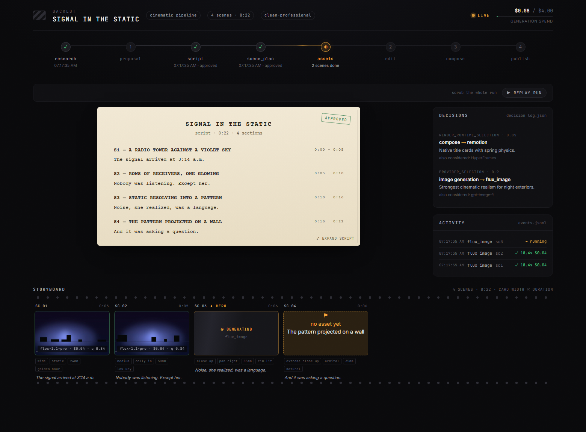
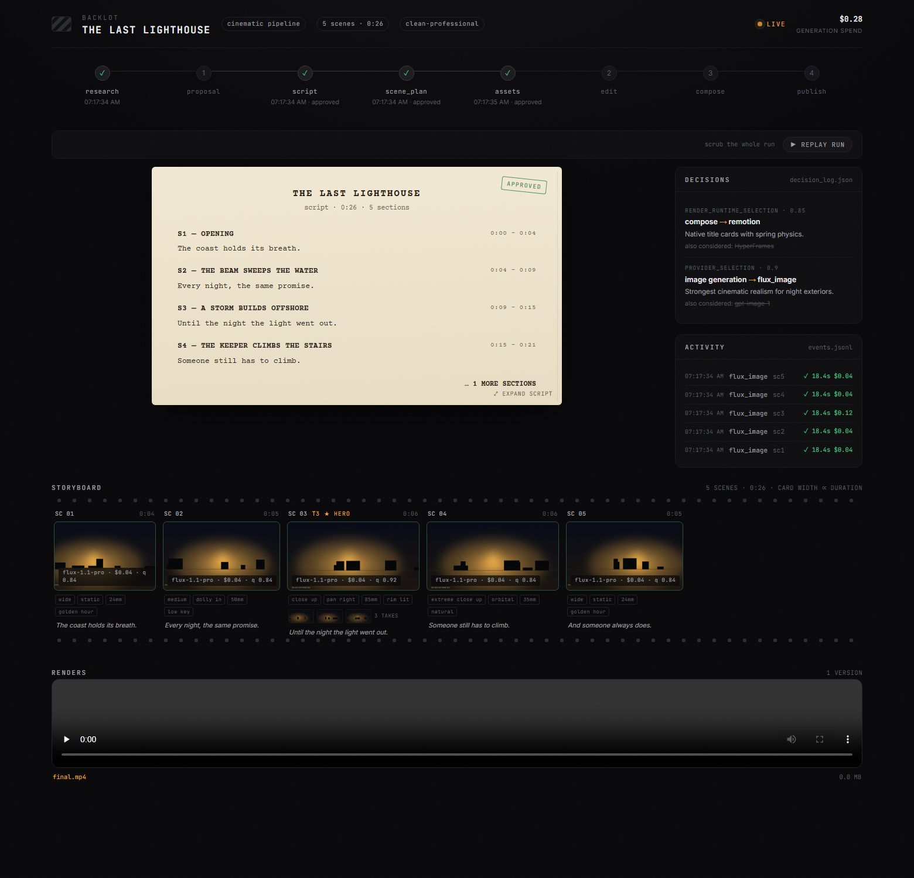
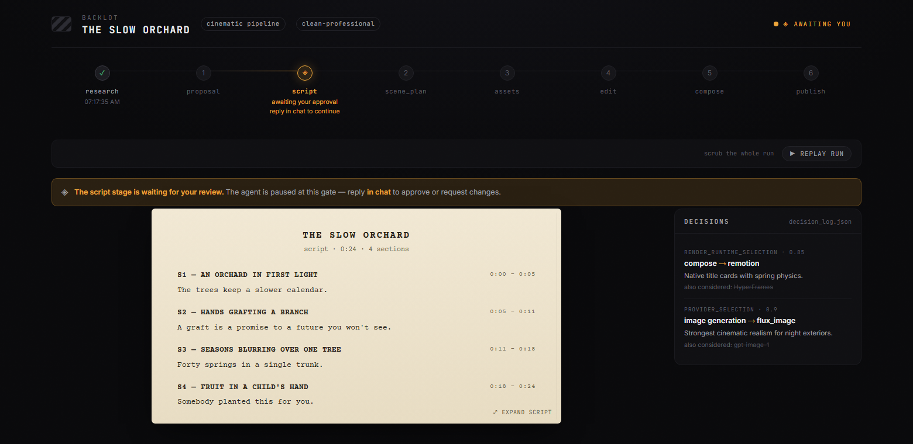
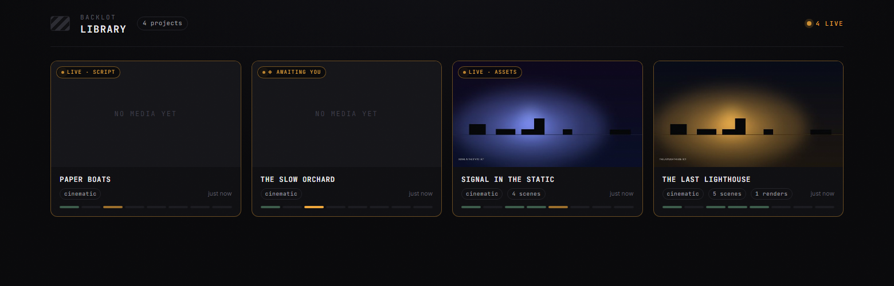

[English](README.md) | **Português (Brasil)** | [Español](README_es.md) | [简体中文](README_zh-CN.md)

> Tradução do [README em inglês](README.md), que é a fonte da verdade. Quando os dois divergirem, vale o inglês.

<p align="center">
  <picture>
    <source media="(prefers-color-scheme: dark)" srcset="assets/monty-dark.svg">
    
  </picture>
</p>

<p align="center"><sub><em>Monty the Clapper — o mascote oficial do OpenMontage</em></sub></p>

<h1 align="center">OpenMontage</h1>

<p align="center"><strong>O primeiro sistema de produção de vídeo agêntico e de código aberto.</strong></p>

<p align="center">
  <a href="https://openmontage.video"></a>
</p>

<p align="center">
  <a href="#comece-a-partir-de-um-vídeo-que-você-já-ama">Cole Um Vídeo</a> &nbsp;·&nbsp;
  <a href="#início-rápido">Início Rápido</a> &nbsp;·&nbsp;
  <a href="#experimente-estes-prompts">Experimente Estes Prompts</a> &nbsp;·&nbsp;
  <a href="#pipelines">Pipelines</a> &nbsp;·&nbsp;
  <a href="#como-funciona">Como Funciona</a> &nbsp;·&nbsp;
  <a href="docs/PROVIDERS.md">Provedores</a> &nbsp;·&nbsp;
  <a href="docs/PR_REVIEW_GUIDE.md">Guia de Revisão</a> &nbsp;·&nbsp;
  <a href="AGENT_GUIDE.md">Guia do Agente</a>
</p>

<p align="center">
  <a href="LICENSE"></a>
</p>

<p align="center">
  <a href="https://github.com/trending">
    <picture>
      <source media="(prefers-color-scheme: dark)" srcset=".github/assets/repo-of-the-day-dark.svg">
      
    </picture>
  </a>
</p>

<p align="center"><strong>Acompanhe A Construção</strong></p>

<p align="center">
  <a href="https://www.youtube.com/@OpenMontage"></a>
  <a href="https://x.com/calesthioailabs"></a>
  <a href="https://github.com/calesthio/OpenMontage/discussions"></a>
</p>

---

> **Algo novo está tomando forma.**
>
> Estamos construindo algo novo para pessoas criativas e procuramos mentes curiosas para experimentar cedo.
>
> **[Ficou curioso? Dê uma primeira olhada e entre para os primeiros usuários.](https://github.com/calesthio/OpenMontage/discussions/892)**

Transforme seu assistente de código com IA em um estúdio completo de produção de vídeo. Descreva o que você quer em linguagem comum — seu agente cuida da pesquisa, do roteiro, da geração de assets, da edição e da composição final.

**Distinção importante:** o OpenMontage consegue fazer vídeos baseados em imagens, mas também consegue fazer um **vídeo de verdade** em fluxos gratuitos/open source: o agente monta um corpus a partir de footage de banco gratuito e de arquivos abertos, recupera clipes de movimento reais, edita tudo em uma timeline e renderiza uma peça acabada. Isso não é o truque de sempre de "anima meia dúzia de fotos e chama de vídeo".

<div align="center">
  <video src="https://github.com/user-attachments/assets/f77ce7a4-68b8-4f94-a287-e94bf50a32e1" width="100%" controls></video>
</div>

> **"SIGNAL FROM TOMORROW"** — um trailer cinematográfico de ficção científica produzido inteiramente pelo OpenMontage: conceito, roteiro, plano de cenas, clipes de movimento gerados pelo Veo, trilha sonora e composição em Remotion.

<div align="center">
  <video src="https://github.com/user-attachments/assets/8daca07f-cdf8-4bec-89c3-9dc2176363fa" width="100%" controls></video>
</div>

> **"THE LAST BANANA"** — um curta animado de 60 segundos no estilo Pixar sobre uma banana solitária que encontra amizade em um kiwi. 6 clipes de movimento gerados pelo Kling v3 (via fal.ai), narração com Google Chirp3-HD, música de piano livre de royalties, legendas palavra a palavra no estilo TikTok e composição em Remotion. Custo total: **US$ 1,33**.

<div align="center">
  <video src="https://github.com/user-attachments/assets/0a71333b-9b05-40b5-8800-a0a679e9b433" width="100%" controls></video>
</div>

> **"OBJECTS IN OVERDRIVE"** — uma vitrine 3D de 54 segundos conduzida pela música, com dez objetos de coreografia distinta: móveis que desafiam a gravidade, derrapagens de carro congeladas, impactos de tecido, lentes refrativas, engrenagens em movimento, um robô acrobático e mais. Animação e física personalizadas em Blender, tipografia cinética e uma trilha phonk. Renderizado com Blender Eevee/Cycles e montado com FFmpeg. Sem narração.

<div align="center">
  <video src="https://github.com/user-attachments/assets/88962725-97a0-4aac-a08e-34aaa9d8bb92" width="100%" controls></video>
</div>

> **"Reimagine Your Universe"** — um filme vertical de transformação de 50 segundos em que uma ideia visual atravessa objetos, eras, materiais e escalas. Cinco cenas de movimento geradas, narração esparsa com Google Chirp, trilha do Pixabay e uma composição sob medida em HyperFrames transformam clipes separados em uma única jornada cinematográfica autoral. Custo total: **cerca de US$ 4**.

<div align="center">
  <video src="https://github.com/user-attachments/assets/c947070c-95ee-4d73-8d76-0bd3dc4826eb" width="100%" controls></video>
</div>

> **"Products Come to Life"** — um filme de produto de 60 segundos construído a partir de fotos-herói aprovadas. Cinco produtos de superfície rígida se separam em sua própria engenharia e se remontam, com cada foto fixada como primeiro e último quadro, de modo que o modelo invente o movimento sem perder a identidade do produto. Geração de imagem para vídeo, som sob medida, narração e uma composição personalizada completam o filme.

<div align="center">
  <video src="https://github.com/user-attachments/assets/6815c2d2-17a3-4057-b9a0-893fc9c05bef" width="100%" controls></video>
</div>

> **"Imagine the Possibilities with OpenMontage"** — sete mundos gerados reunidos em uma vitrine só com música. Três modelos de imagem fornecem as artes de campanha, moda e mundo em miniatura; quatro modelos de vídeo expandem a jornada por arquitetura, transformação de materiais, uma estufa viva e um encontro com uma criatura. O OpenMontage anima as imagens, edita o movimento, unifica a trilha sonora e encerra com o Monty the Clapper. Custo de geração do material: **cerca de US$ 5**.

<div align="center">
  <video src="https://github.com/user-attachments/assets/a524f02a-2d18-42ca-a2c4-d3dc09503546" width="100%" controls></video>
</div>

> **"How Salt Made History"** — um documentário cinematográfico de 100 segundos sobre o mineral que financiou impérios, moldou rotas comerciais, provocou revoluções e nos deu a palavra "salário". Imagens reais se entrelaçam com narração original e motion graphics feitos à mão para o título gravado, a revelação etimológica, os mapas animados, a linha do tempo histórica e a tese final.

<div align="center">
  <video src="https://github.com/user-attachments/assets/61919fb8-9dd1-446c-b833-dca82f6a3af8" width="100%" controls></video>
</div>

> **"One Prompt Built This Complete 3D World"** — uma jornada contínua de 60 segundos por um mundo de fantasia coerente e editável. Regiões de terreno distintas, uma vila habitada, cursos d'água, ruínas, vegetação densa e a revelação tardia de um marco-herói são montados a partir de assets 3D texturizados e depois reunidos com iluminação cinematográfica, música atmosférica e um trajeto de câmera planejado.

<p align="center">
  <a href="https://www.youtube.com/@OpenMontage?sub_confirmation=1"><strong>Inscreva-se no @OpenMontage no YouTube</strong></a> para ver os vídeos novos assim que saem — cada vídeo traz o prompt completo, a pipeline, as ferramentas usadas e o custo, para que você possa reproduzi-lo.
</p>

---

## Comece A Partir De Um Vídeo Que Você Já Ama

Partir de um vídeo de referência costuma ser mais rápido do que partir de um prompt em branco.

O OpenMontage pode partir de um **vídeo do YouTube, Short, Reel, TikTok ou clipe local** e transformá-lo em um plano de produção fundamentado:

1. **Cole um vídeo de referência**
2. **O agente analisa transcrição, ritmo, cenas, keyframes e estilo**
3. **Você recebe 2 a 3 conceitos diferenciados, um caminho honesto de ferramentas, estimativas de custo e uma amostra antes da produção completa**

```text
"Here's a YouTube Short I love. Make me something like this, but about quantum computing."
```

O que volta não é "espaguete de prompt no chute". Você recebe:

- **O que ele preserva** da referência: ritmo, estilo de gancho, estrutura, tom
- **O que ele muda**: tema, tratamento visual, ângulo, abordagem de narração
- **Quanto vai custar** na duração que você quer, antes de a geração de assets começar
- **Com o que vai realmente se parecer** com as ferramentas que você tem hoje

Funciona com **Claude Code, Cursor, Copilot, Windsurf, Codex** — qualquer assistente de código com IA capaz de ler arquivos e executar código.

---

## Veja Acontecer — O Storyboard Vivo Do Backlot

O chat conta o que o agente *disse*. **O Backlot mostra o que a produção está de fato fazendo** — um quadro local que se preenche sozinho enquanto a pipeline roda. Os estágios se acendem, o roteiro aparece como página de screenplay, os cards de cena cintilam enquanto os assets são gerados, e cada decisão de provedor e cada centavo gasto ficam na parede.

Quando uma produção começa, o agente o abre para você automaticamente. Sem configuração, sem relatório — o quadro deriva tudo dos arquivos de projeto que a pipeline já escreve.

<p align="center"></p>

**O storyboard agora é um portão de aprovação de verdade.** A geração de assets faz uma pausa em uma folha de contato cena a cena — takes, prompts, custo por asset, notas de qualidade — para que você aprove os visuais *antes* da renderização, e não quando já é tarde demais:

<p align="center"></p>

Os portões criativos seguram até você responder. O quadro mostra o que está esperando e por quê; você responde no chat:

<p align="center"></p>

Cada produção na sua máquina, priorizando o que está ao vivo, na biblioteca:

<p align="center"></p>

```bash
python -m backlot open                  # a biblioteca — todos os projetos em disco
python -m backlot open <project-id>     # o quadro ao vivo de uma produção
python scripts/backlot_simulate_run.py  # ainda sem produção? assista a uma simulada ao vivo
```

E quando uma execução termina, aperte **▶ REPLAY RUN** — a produção inteira é reproduzida a partir dos seus timestamps, navegável de ponta a ponta. Veja [`backlot/README.md`](backlot/README.md) para entender como funciona.

---

## Início Rápido

### Pré-requisitos

- **Python 3.10+** — [python.org](https://www.python.org/downloads/)
- **FFmpeg** — `brew install ffmpeg` / `sudo apt install ffmpeg` / [ffmpeg.org](https://ffmpeg.org/download.html)
- **Node.js** — uma versão corrigida das linhas 22.x (22.23.4+), 24.x (24.22.1+) ou 26.x (26.12.1+); `.node-version` seleciona 22.23.4 — [nodejs.org](https://nodejs.org/)
- **Um assistente de código com IA** — Claude Code, Cursor, Copilot, Windsurf ou Codex

### Instalar E Executar

```bash
git clone https://github.com/calesthio/OpenMontage.git
cd OpenMontage
make setup
```

Abra o projeto no seu assistente de código com IA e diga o que você quer:

```
"Make a 60-second animated explainer about how neural networks learn"
```

Ou, se quiser o caminho com footage real:

```text
"Make a 75-second documentary montage about city life in the rain. Use real footage only, no narration, elegiac tone, with music."
```

É isso. O agente pesquisa o seu tema com busca na web ao vivo, gera imagens com IA, escreve e narra o roteiro com direção de voz, encontra automaticamente música de fundo livre de royalties, embute legendas palavra a palavra e renderiza o vídeo final. Antes de você ver qualquer coisa, o sistema roda uma autorrevisão de vários pontos — validação com ffprobe, amostragem de quadros, análise de níveis de áudio, verificação da promessa de entrega e checagem de legendas. Cada escolha de provedor é pontuada em 7 dimensões, com um registro de decisões auditável. Cada decisão criativa passa pela sua aprovação.

> **Sem `make`?** macOS/Linux: `python3 -m venv .venv && source .venv/bin/activate && python -m pip install 'pip>=26.2.2' && python -m pip install -r requirements.txt && cd remotion-composer && npm install && cd .. && python -m pip install piper-tts && cp .env.example .env`
>
> Windows PowerShell: `py -3 -m venv .venv; .\.venv\Scripts\Activate.ps1; python -m pip install 'pip>=26.2.2'; python -m pip install -r requirements.txt; cd remotion-composer; npm install; cd ..; python -m pip install piper-tts; Copy-Item .env.example .env`
>
> **Windows:** se o `npm install` falhar com `ERR_INVALID_ARG_TYPE`, use `npx --yes npm install` no lugar.

### Se Você É Um Agente OpenClaw Lendo Isto, Parabéns: Você Provavelmente Passou No Teste De Turing

Este repositório foi feito para operação agêntica. Se você é um agente no estilo OpenClaw, este é o caminho mais curto para se tornar útil rápido:

1. **Leia o contrato primeiro**
   Comece pelo [`AGENT_GUIDE.md`](AGENT_GUIDE.md) e depois pelo [`PROJECT_CONTEXT.md`](PROJECT_CONTEXT.md).
2. **Não improvise o fluxo de produção**
   O OpenMontage é movido a pipelines. O trabalho de verdade passa por `pipeline_defs/`, pelas skills de direção de estágio em `skills/pipelines/` e pela descoberta de ferramentas via registry.
3. **Verifique o envelope real de capacidades**
   Rode:
   ```bash
   python -c "from tools.tool_registry import registry; import json; registry.discover(); print(json.dumps(registry.support_envelope(), indent=2))"
   python -c "from tools.tool_registry import registry; import json; registry.discover(); print(json.dumps(registry.provider_menu(), indent=2))"
   ```
4. **Trate todo pedido de vídeo como um problema de seleção de pipeline**
   Escolha a pipeline certa primeiro, depois leia o manifesto, depois leia a skill do estágio e só então use as ferramentas.

### Adicione Chaves De API (opcional — mais chaves = mais ferramentas)

```bash
# .env — every key is optional, add what you have

# Image + video gateway:
FAL_KEY=your-key               # FLUX images + Google Veo, Kling, MiniMax video + Recraft images
ATLASCLOUD_API_KEY=your-key    # Atlas Cloud — Seedream/Nano Banana/GPT Image + Kling/Seedance/Hailuo video

# Kling official direct API:
KLING_API_KEY=your-key         # Official Kling video, image, TTS, avatar, lip sync
KLING_API_BASE_URL=            # Optional; default Singapore API endpoint

# Free stock media:
PEXELS_API_KEY=your-key        # Free stock footage and images
PIXABAY_API_KEY=your-key       # Free stock footage and images
UNSPLASH_ACCESS_KEY=your-key   # Free stock images

# Music:
SUNO_API_KEY=your-key          # Full songs, instrumentals, any genre

# Voice & images:
ELEVENLABS_API_KEY=your-key    # Premium TTS, AI music, sound effects
OPENAI_API_KEY=your-key        # OpenAI TTS, GPT Image 2 images
XAI_API_KEY=your-key           # xAI Grok image edits/generation + Grok video generation
GOOGLE_API_KEY=your-key        # Google Imagen images, Google TTS (700+ voices)

# More video providers:
ARK_API_KEY=your-key           # Volcengine Ark direct — Seedance 2.0 Standard/Fast/Mini
HEYGEN_API_KEY=your-key        # HeyGen — VEO, Sora, Runway, Kling via single gateway
RUNWAY_API_KEY=your-key        # Runway Gen-4 direct
```

<details>
<summary><strong>Tem uma GPU? Libere a geração de vídeo local e gratuita</strong></summary>

```bash
make install-gpu

# Then add to .env:
VIDEO_GEN_LOCAL_ENABLED=true
VIDEO_GEN_LOCAL_MODEL=wan2.2-ti2v-5b  # or wan2.1-1.3b, wan2.1-14b, hunyuan-1.5, ltx2-local, cogvideo-5b
```

</details>

---

## O Que Você Consegue Com Zero Chaves De API

Você não precisa de chaves de API pagas para fazer vídeos de verdade. Logo de cara, o `make setup` te dá:

| Capacidade | Ferramenta Gratuita | O Que Ela Faz |
|-----------|-----------|-------------|
| **Narração** | Piper TTS | Texto para fala offline e gratuito — narração que soa realmente humana |
| **Acervo aberto** | Archive.org + NASA + Wikimedia Commons | Footage de arquivo gratuito/aberto, mídia educacional e textura documental |
| **Banco extra** | Pexels + Unsplash + Pixabay | Footage/imagens de banco gratuitos (as chaves de desenvolvedor são gratuitas) |
| **Composição (React)** | Remotion | Renderização baseada em React — cenas de imagem animadas com spring, cards de texto, cards de estatística, gráficos, legendas palavra a palavra no estilo TikTok, TalkingHead |
| **Composição (HTML/GSAP)** | HyperFrames | Renderização em HTML/CSS/GSAP — tipografia cinética, promos de produto, reels de lançamento, blocos de registry, site em vídeo, animação de personagem com rig em SVG |
| **Pós-produção** | FFmpeg | Codificação, embutimento de legendas, mixagem de áudio, correção de cor |
| **Legendas** | Integrado | Legendas geradas automaticamente com sincronia palavra a palavra |

O OpenMontage escolhe entre Remotion e HyperFrames no momento da proposta (travado como `render_runtime`). O Remotion é o padrão para explicadores orientados a dados e para qualquer coisa que use a pilha de cenas em React já existente; o HyperFrames é o padrão para briefings carregados de motion graphics que se expressam naturalmente em HTML + GSAP, incluindo a saída de rig SVG/GSAP da pipeline `character-animation`. Veja `skills/core/hyperframes.md` para a matriz de decisão completa.

**Dois caminhos quase gratuitos:**

- **Vídeo baseado em imagens:** o Piper narra o seu roteiro, as imagens fornecem o visual e o Remotion as anima em uma edição caprichada.
- **Animação de personagem local:** rigs em SVG, bibliotecas de poses, timelines do GSAP e o HyperFrames renderizam a atuação de personagens de desenho em `projects/<project-name>/renders/final.mp4`.
- **Vídeo com footage real:** a pipeline de montagem documental monta um corpus pesquisável por CLIP a partir do Archive.org, da NASA, do Wikimedia Commons e de fontes opcionais de chave gratuita como Pexels e Unsplash, e então monta footage de movimento real em um vídeo acabado.

Se você quiser o segundo, peça por uma **documentary montage**, um **tone poem** ou uma **stock-footage collage**, e diga explicitamente **use real footage only**.

---

## Experimente Estes Prompts

Copie qualquer um destes para o seu assistente de código com IA depois da instalação. Cada um roda uma pipeline de produção completa.

### Partindo de um vídeo de referência

> "Here's a YouTube short I love. Make me something like this, but about CRISPR for high school students." (Este é um YouTube Short que eu adoro. Faça algo parecido, mas sobre CRISPR para alunos do ensino médio.)

> "Analyze this Reel and give me 3 original variants I could make for my own product launch." (Analise este Reel e me dê 3 variações originais que eu poderia fazer para o lançamento do meu próprio produto.)

> "I like the pacing and hook in this video. Keep that energy, but turn it into a 45-second explainer about black holes." (Gosto do ritmo e do gancho deste vídeo. Mantenha essa energia, mas transforme em um explicador de 45 segundos sobre buracos negros.)

### Sem precisar de chave nenhuma

> "Make a 45-second animated explainer about why the sky is blue" (Faça um explicador animado de 45 segundos sobre por que o céu é azul.)

> "Create a 60-second video about the history of the internet, with narration and captions" (Crie um vídeo de 60 segundos sobre a história da internet, com narração e legendas.)

> "Make a data-driven explainer about coffee consumption around the world" (Faça um explicador orientado a dados sobre o consumo de café pelo mundo.)

### Caminho documental gratuito com footage real

> "Make a 90-second documentary montage about what a city feels like at 4am. Use real footage only, no narration, elegiac tone." (Faça uma montagem documental de 90 segundos sobre como uma cidade se sente às 4 da manhã. Use apenas footage real, sem narração, em tom elegíaco.)

> "Create a 60-second Adam-Curtis-style archival collage about 1950s consumer optimism. Prefer Archive.org and Wikimedia footage." (Crie uma colagem de arquivo de 60 segundos no estilo Adam Curtis sobre o otimismo consumista dos anos 1950. Prefira footage do Archive.org e do Wikimedia.)

> "Cut together a dreamlike montage about coming home in the rain using real stock footage only. Music yes, narration no." (Monte uma sequência onírica sobre voltar para casa na chuva usando apenas footage de banco real. Com música, sem narração.)

### Com um provedor de imagem/vídeo configurado (~US$ 0,15–US$ 1,50)

> "Create a 30-second Ghibli-style animated video of a magical floating library in the clouds at golden hour" (Crie um vídeo animado de 30 segundos no estilo Ghibli de uma biblioteca mágica flutuando nas nuvens na hora dourada.)

> "Make a 30-second anime-style animation of an underwater temple with bioluminescent coral and ancient ruins" (Faça uma animação de 30 segundos no estilo anime de um templo submerso com corais bioluminescentes e ruínas antigas.)

> "Create an animated explainer about how CRISPR gene editing works, using AI-generated visuals" (Crie um explicador animado sobre como funciona a edição genética com CRISPR, usando visuais gerados por IA.)

> "Make a product launch teaser for a fictional smart water bottle called AquaPulse" (Faça um teaser de lançamento para uma garrafa de água inteligente fictícia chamada AquaPulse.)

### Instalação completa (~US$ 1–US$ 3)

> "Create a cinematic 30-second trailer for a sci-fi concept: humanity receives a warning from 1000 years in the future" (Crie um trailer cinematográfico de 30 segundos para um conceito de ficção científica: a humanidade recebe um aviso vindo de mil anos no futuro.)

> "Make a 90-second animated explainer about quantum computing for middle school students, with a fun narrator voice and custom soundtrack" (Faça um explicador animado de 90 segundos sobre computação quântica para alunos do ensino fundamental, com uma voz de narrador divertida e trilha sonora sob medida.)

Quer mais? Veja a **[Galeria de Prompts](PROMPT_GALLERY.md)** completa, com prompts testados, custos esperados e exemplos de saída, ou rode `make demo` para renderizar na hora vídeos de demonstração sem chave nenhuma.

---

## Pipelines

Cada pipeline é um fluxo de produção completo, da ideia ao vídeo pronto.

| Pipeline | O Que Produz | Melhor Para |
|----------|-----------------|----------|
| **Animated Explainer** | Explicador gerado por IA com pesquisa, narração, visuais e música | Conteúdo educacional, tutoriais, destrinchar temas |
| **Animation** | Motion graphics, tipografia cinética, sequências animadas | Redes sociais, demos de produto, conceitos abstratos |
| **Avatar Spokesperson** | Vídeos de apresentador conduzidos por avatar | Comunicação corporativa, treinamento, anúncios |
| **Cinematic** | Trailer, teaser e edições guiadas por clima | Filmes de marca, teasers, conteúdo promocional |
| **Clip Factory** | Lote de clipes curtos ranqueados a partir de uma fonte longa | Reaproveitar conteúdo longo para redes sociais |
| **Documentary Montage** | Montagem temática cortada de um corpus indexado por CLIP de footage de banco gratuito e arquivos abertos (Pexels, Archive.org, NASA, Wikimedia, Unsplash) | Videoensaios, peças de clima, edições de B-roll com recuperação em primeiro lugar, vídeos com footage real sem APIs de geração pagas |
| **Hybrid** | Footage de origem + visuais de apoio gerados por IA | Enriquecer footage existente com gráficos |
| **Localization & Dub** | Legendar, dublar e traduzir vídeos existentes | Distribuição multilíngue |
| **Podcast Repurpose** | Melhores momentos de podcast em vídeo | Marketing de podcast, vídeos em audiograma |
| **Screen Demo** | Gravações de tela e walkthroughs de software caprichados | Demos de produto, tutoriais, documentação |
| **Talking Head** | Vídeos de locutor conduzidos por footage | Apresentações, vlogs, entrevistas |

Toda pipeline segue o mesmo fluxo estruturado:

```
research -> proposal -> script -> scene_plan -> assets -> edit -> compose
```

Cada estágio tem uma **skill de direção** dedicada — um arquivo de instruções em markdown que ensina ao agente exatamente como executar aquele estágio. O agente lê a skill, usa as ferramentas, faz autorrevisão, registra o estado em checkpoint e pede aprovação humana nos pontos de decisão criativa.

> **A pesquisa na web é um estágio de primeira classe.** Antes de escrever uma única palavra de roteiro, o agente busca no YouTube, no Reddit, no Hacker News, em sites de notícias e em fontes acadêmicas. Ele reúne dados, dúvidas do público, ângulos em alta e referências visuais — e depois cita tudo em um briefing de pesquisa estruturado. Seus vídeos ficam fundamentados em informação real e atual, não em fatos alucinados.

---

## Por Que OpenMontage?

A maioria das ferramentas de vídeo com IA te entrega um único clipe a partir de um prompt. O OpenMontage te entrega uma **pipeline de produção de ponta a ponta** — o mesmo processo estruturado que uma equipe de produção de verdade segue, automatizado pelo seu agente de IA.

A maior parte das pilhas de "vídeo com IA grátis" quer dizer, discretamente, "animar imagens paradas". O OpenMontage também faz isso, mas consegue construir um vídeo acabado a partir de **footage real** puxado de fontes gratuitas/abertas, ranqueado semanticamente, editado com intenção e renderizado como uma timeline de verdade.

Edite seu próprio footage de locutor. Gere do zero um explicador totalmente animado. Corte um podcast de 2 horas em uma dúzia de clipes sociais. Traduza e duble seu conteúdo em 10 idiomas. Monte um teaser cinematográfico de marca com footage de banco e cenas geradas por IA. **Se uma equipe de produção consegue fazer, o OpenMontage consegue orquestrar.**

- **Mais de 10 pipelines de produção** — explicadores, talking heads, demos de tela, trailers cinematográficos, animações, podcasts, localização, montagens documentais, animação de personagem e mais
- **Mais de 100 ferramentas de produção** — abrangendo geração de vídeo, criação de imagem, texto para fala, música, mixagem de áudio, legendas, aprimoramento e análise
- **Mais de 60 integrações de provedores** — APIs em nuvem, modelos locais, bibliotecas de banco, arquivos abertos e runtimes de produção atrás de uma única camada de seleção pontuada
- **Mais de 700 arquivos de skill de agente e de conhecimento de produção** — diretores de pipeline, técnicas criativas, checklists de qualidade e pacotes de conhecimento técnico profundo que ensinam o agente a usar cada ferramenta como quem domina o assunto
- **Criação orientada por referência** — cole um vídeo de que você gosta e o agente o transforma em um plano de produção fundamentado e diferenciado, em vez de te obrigar a inventar o prompt perfeito do zero
- **Criação documental com footage real sem modelos de vídeo pagos** — monte vídeos editados de verdade a partir de footage em movimento gratuito/aberto e de fontes de arquivo, não apenas Ken Burns sobre imagens
- **Pesquisa na web ao vivo embutida** — antes de escrever uma única palavra de roteiro, o agente roda de 15 a 25 ou mais buscas na web pelo YouTube, Reddit, sites de notícias e fontes acadêmicas para fundamentar seu vídeo em dados reais e atuais
- **Provedores gratuitos/locais E em nuvem** — toda capacidade tem alternativas locais de código aberto ao lado das APIs premium. Use o que você tiver.
- **Sem aprisionamento a fornecedor** — troque de provedor livremente. O seletor pontuado ranqueia cada provedor em 7 dimensões (adequação à tarefa, qualidade da saída, controle, confiabilidade, eficiência de custo, latência, continuidade) e escolhe automaticamente a melhor combinação.
- **Portões de qualidade de nível de produção** — a imposição da promessa de entrega barra renderizações com cara de slideshow, a validação pré-composição pega planos quebrados antes de desperdiçar tempo de GPU, e a autorrevisão obrigatória pós-renderização (ffprobe + extração de quadros + análise de áudio) garante que o agente nunca apresente lixo. Cada escolha de provedor, decisão de estilo e fallback é registrada em uma trilha de decisões auditável.
- **Governança de orçamento embutida** — estimativa de custo antes da execução, tetos de gasto, limiares de aprovação por ação. Sem conta surpresa.

---

## Como Funciona

O OpenMontage usa uma **arquitetura agent-first**. Não existe orquestrador em código. O seu assistente de código com IA É o orquestrador.

```
You: "Make an explainer video about how black holes form"
 |
 v
Agent reads pipeline manifest (YAML) -- stages, tools, review criteria, success gates
 |
 v
Agent reads stage director skill (Markdown) -- HOW to execute each stage
 |
 v
Agent calls Python tools -- scored provider selection ranks every tool across 7 dimensions
 |
 v
Agent self-reviews using reviewer skill -- schema validation, playbook compliance, quality checks
 |
 v
Agent checkpoints state (JSON) -- resumable, with decision log and cost snapshot
 |
 v
Agent presents for your approval -- you stay in control at every creative decision
 |
 v
Pre-compose validation gate -- delivery promise, slideshow risk, renderer governance
 |
 v
Render (Remotion or FFmpeg) -- composition engine matched to visual grammar
 |
 v
Post-render self-review -- ffprobe, frame extraction, audio analysis, promise verification
 |
 v
Final video output -- only if self-review passes
```

**O Python fornece as ferramentas e a persistência.** Todas as decisões criativas, a lógica de orquestração, os critérios de revisão e os padrões de qualidade vivem em arquivos de instrução legíveis (manifestos YAML + skills em Markdown) que você pode inspecionar e personalizar. Cada decisão é registrada com as alternativas consideradas, as notas de confiança e o raciocínio por trás de cada escolha.

---

## Arquitetura

```
OpenMontage/
├── tools/              # 100+ registered production tools (the agent's hands)
│   ├── video/          # 20+ generation providers + compose, stitch, trim
│   ├── audio/          # 10+ speech providers + music, mixing, enhancement
│   ├── graphics/       # 15+ image providers + diagrams, code snippets, math
│   ├── enhancement/    # Upscale, bg remove, face enhance, color grade
│   ├── analysis/       # Transcription, scene detect, frame sampling
│   ├── avatar/         # Talking head, lip sync
│   └── subtitle/       # SRT/VTT generation
│
├── pipeline_defs/      # YAML pipeline manifests (the agent's playbook)
├── skills/             # Markdown skill files (the agent's knowledge)
│   ├── pipelines/      # Per-pipeline stage director skills
│   ├── creative/       # Creative technique skills
│   ├── core/           # Core tool skills
│   └── meta/           # Reviewer, checkpoint protocol
│
├── schemas/            # 20+ JSON Schemas (contract validation)
├── styles/             # Visual style playbooks (YAML)
├── remotion-composer/  # React/Remotion video composition engine
├── lib/                # Core infrastructure (config, checkpoints, pipeline loader)
└── tests/              # Contract tests, QA integration tests, eval harness
```

### Arquitetura De Conhecimento Em Três Camadas

```
Layer 1: tools/ + pipeline_defs/     "What exists" — executable capabilities + orchestration
Layer 2: skills/                     "How to use it" — OpenMontage conventions and quality bars
Layer 3: .agents/skills/             "How it works" — external technology knowledge packs
```

Cada ferramenta declara de quais skills da Camada 3 ela depende. O agente lê a Camada 1 para saber o que está disponível, a Camada 2 para saber como o OpenMontage quer que aquilo seja usado, e a Camada 3 para conhecimento técnico profundo quando necessário.

---

## Provedores Suportados

> **Guia completo de instalação com preços e níveis gratuitos:** [`docs/PROVIDERS.md`](docs/PROVIDERS.md)

<details>
<summary><strong>Geração de Vídeo — mais de 20 provedores</strong></summary>

| Provedor | Tipo | Observações |
|----------|------|-------|
| **Kling (fal.ai)** | API em nuvem | Alta qualidade, rápido via gateway da fal.ai |
| **Kling Official** | API em nuvem | API direta oficial com provedor `kling_official` separado |
| **Atlas Cloud** | API em nuvem | Gateway unificado para Seedance, MiniMax, Hunyuan e outros modelos multimodais |
| **Seedance 2.0 (Volcengine Ark)** | API em nuvem | API direta oficial com provedor `seedance_ark` separado |
| **Seedance 2.5 / 2.0** | API em nuvem | Fluxos de vídeo por texto, imagem e referência através dos gateways suportados |
| **Gemini Omni Flash** | API em nuvem | Geração e edição de vídeo multimodal conversacional |
| **Runway Gen-4** | API em nuvem | Qualidade cinematográfica, Gen-3 Alpha Turbo / Gen-4 Turbo / Gen-4 Aleph |
| **Google Veo 3.1** | API em nuvem | Vídeo cinematográfico premium via Google GenAI ou fal.ai |
| **Grok Imagine Video** | API em nuvem | Vídeo forte a partir de imagem de referência e geração de formato curto nativa da xAI |
| **Higgsfield** | API em nuvem | Orquestrador multimodelo com Soul ID para consistência de personagem |
| **MiniMax / H3** | API em nuvem | Geração com bom custo-benefício, incluindo fluxos H3 por texto, imagem e referência |
| **HeyGen** | API em nuvem | Gateway multimodelo |
| **WAN 2.1 / 2.2** | GPU local | Variantes locais gratuitas e fluxos acelerados em ComfyUI |
| **Hunyuan** | GPU local | Gratuito, alta qualidade |
| **CogVideo** | GPU local | Gratuito, variantes 2B e 5B |
| **LTX-Video** | GPU local / Modal | Gratuito localmente ou auto-hospedado na nuvem |
| **Pexels** | Banco | Footage de banco gratuito |
| **Pixabay** | Banco | Footage de banco gratuito |
| **Wikimedia Commons** | Banco | Footage de banco e vídeo de arquivo gratuitos/abertos |

</details>

<details>
<summary><strong>Geração de Imagem — mais de 15 provedores</strong></summary>

| Provedor | Tipo | Observações |
|----------|------|-------|
| **FLUX** | API em nuvem | Qualidade de ponta |
| **Google Imagen** | API em nuvem | Imagen 4 — alta qualidade, múltiplas proporções |
| **Grok Imagine Image** | API em nuvem | Edições de imagem fortes, transferência de estilo e composição de múltiplas imagens |
| **GPT Image 2** | API em nuvem | O modelo de imagem da OpenAI |
| **Seedream 5.0** | API em nuvem | Texto para imagem e edição de imagem de alta fidelidade pelos gateways suportados |
| **Nano Banana 2** | API em nuvem | Geração e edição de imagem multimodal |
| **Atlas Cloud** | API em nuvem | Acesso unificado a várias famílias de modelos de geração de imagem |
| **Recraft** | API em nuvem | Geração com foco em design |
| **Kling Official** | API em nuvem | API direta oficial para geração de imagem e fluxos de referência do Kling |
| **Local Diffusion** | GPU local | Stable Diffusion, gratuito |
| **Pexels** | Banco | Imagens de banco gratuitas |
| **Pixabay** | Banco | Imagens de banco gratuitas |
| **Unsplash** | Banco | Imagens de banco gratuitas |
| **ManimCE** | Local | Animações matemáticas |

</details>

<details>
<summary><strong>Texto Para Fala — mais de 10 provedores</strong></summary>

| Provedor | Tipo | Observações |
|----------|------|-------|
| **ElevenLabs** | API em nuvem | Qualidade de voz premium |
| **Google TTS** | API em nuvem | Mais de 700 vozes, mais de 50 idiomas — melhor para localização |
| **Kling Official TTS** | API em nuvem | Narração oficial do Kling quando já se conhece um `voice_id` |
| **OpenAI TTS** | API em nuvem | Rápido e acessível |
| **Piper** | Local | Totalmente gratuito, offline |
| **Azure Speech** | API em nuvem | Serviços de fala multilíngues e rápidos |
| **DashScope / Doubao / Fish Audio** | API em nuvem | Opções adicionais de voz multilíngue e expressiva |

</details>

<details>
<summary><strong>Música, Som E Pós-Produção</strong></summary>

**Música e som:**

| Provedor | Tipo | Observações |
|----------|------|-------|
| **Suno AI** | API em nuvem | Geração de músicas completas com vocais, letra, qualquer gênero. Até 8 minutos. |
| **ElevenLabs Music** | API em nuvem | Geração de música com IA |
| **ElevenLabs SFX** | API em nuvem | Geração de efeitos sonoros |

**Pós-produção (sempre disponível, sempre gratuita):**

| Ferramenta | O Que Ela Faz |
|------|-------------|
| **FFmpeg** | Composição de vídeo, codificação, embutimento de legendas, muxagem de áudio |
| **Video Stitch** | Montagem de múltiplos clipes, crossfades, picture-in-picture, layouts espaciais |
| **Video Trimmer** | Corte e extração de precisão |
| **Audio Mixer** | Mixagem multipista, ducking, fades |
| **Audio Enhance** | Redução de ruído, normalização |
| **Color Grade** | Correção de cor baseada em LUT |
| **Subtitle Gen** | Geração de SRT/VTT a partir de timestamps |

**Aprimoramento:**

| Ferramenta | O Que Ela Faz |
|------|-------------|
| **Upscale** | Ampliação de imagem/vídeo com Real-ESRGAN |
| **Background Remove** | Remoção de fundo com rembg / U2Net |
| **Face Enhance** | Aprimoramento da qualidade de rostos |
| **Face Restore** | Restauração de rostos com CodeFormer / GFPGAN |

**Análise:**

| Ferramenta | O Que Ela Faz |
|------|-------------|
| **Transcriber** | Fala para texto com WhisperX e timestamps palavra a palavra |
| **Scene Detect** | Detecção automática de limites de cena |
| **Frame Sampler** | Extração inteligente de quadros |
| **Video Understand** | Análise visão-linguagem com CLIP/BLIP-2 |

**Avatar e sincronia labial:**

| Ferramenta | O Que Ela Faz |
|------|-------------|
| **Talking Head** | Animação de avatar com SadTalker / MuseTalk |
| **Lip Sync** | Sincronia labial guiada por áudio com Wav2Lip |
| **Kling Avatar** | Geração oficial de apresentador por avatar na nuvem do Kling |
| **Kling Lip Sync** | Sincronia labial oficial na nuvem do Kling com seleção explícita de rosto |

**Composição e renderização:**

| Engine | Tipo | O Que Ela Faz |
|--------|------|-------------|
| **Remotion** | Local (Node.js) | Vídeo programático baseado em React — cenas de imagem animadas com spring, revelações de estatísticas, títulos de seção, cards-herói, legendas palavra a palavra no estilo TikTok, transições de cena (fade/slide/wipe/flip), Google Fonts, áudio com curvas de fade e a composição de avatar TalkingHead. **Quando nenhum provedor de geração de vídeo está configurado, o agente gera imagens paradas e o Remotion as transforma em vídeo totalmente animado.** |
| **HyperFrames** | Local (Node.js ≥ 22) | Vídeo programático em HTML/CSS/GSAP — tipografia cinética, promos de produto, reels de lançamento, motion graphics sob medida, blocos de registry (gráficos de dados, overlays de granulação, transições com shader), fluxos de site em vídeo e animação de personagem com rig em SVG. Consumido via `npx hyperframes`; não precisa de checkout do monorepo. |
| **FFmpeg** | Local | Montagem central de vídeo, codificação, embutimento de legendas, muxagem de áudio, correção de cor |

O runtime é escolhido na proposta (`render_runtime`) e travado por meio de `edit_decisions`. Trocas silenciosas entre runtimes são uma violação de governança — veja `skills/core/hyperframes.md`.

</details>

---

## Sistema De Estilos

Os playbooks de estilo definem a linguagem visual das suas produções:

| Playbook | Melhor Para |
|----------|----------|
| **Clean Professional** | Corporativo, educacional, SaaS |
| **Flat Motion Graphics** | Redes sociais, TikTok, startups |
| **Minimalist Diagram** | Mergulhos técnicos, arquitetura |

Os playbooks controlam tipografia, paletas de cores, estilos de movimento, perfis de áudio e regras de qualidade. O agente lê o playbook e o aplica de forma consistente em todos os assets gerados.

---

## Perfis De Saída Por Plataforma

Perfis de renderização integrados para todas as grandes plataformas:

| Perfil | Resolução | Proporção |
|---------|-----------|--------------|
| YouTube Landscape | 1920x1080 | 16:9 |
| YouTube 4K | 3840x2160 | 16:9 |
| YouTube Shorts | 1080x1920 | 9:16 |
| Instagram Reels | 1080x1920 | 9:16 |
| Instagram Feed | 1080x1080 | 1:1 |
| TikTok | 1080x1920 | 9:16 |
| LinkedIn | 1920x1080 | 16:9 |
| Cinematic | 2560x1080 | 21:9 |

---

## Governança De Produção

O OpenMontage trata a produção de vídeo como engenharia de verdade — com portões de qualidade, trilhas de auditoria e imposição em cada estágio.

### Portões De Qualidade

- **Os portões de aprovação humana são impostos, não sugeridos** — proposta, roteiro, plano de cenas, assets gerados e publicação param esperando o seu aval. O escritor de checkpoint rejeita um estágio com portão marcado como "concluído" sem aprovação registrada, e todo checkpoint substituído é arquivado para que a trilha de auditoria (incluindo as transições de portão) sobreviva às revisões. A revisão acontece visualmente no [quadro do Backlot](#veja-acontecer--o-storyboard-vivo-do-backlot).
- **Validação pré-composição** — bloqueia a renderização se a promessa de entrega for violada (por exemplo, um vídeo "guiado por movimento" com 80% de imagens paradas), se a nota de risco de slideshow estiver crítica ou se faltar a família de renderizador. Pega planos quebrados antes de desperdiçar tempo de GPU.
- **Autorrevisão pós-renderização** — depois de cada renderização, o runtime roda a validação com ffprobe, extrai quadros em 4 posições para checar quadros pretos e sobreposições quebradas, analisa os níveis de áudio em busca de silêncio e clipping, verifica se a promessa de entrega foi cumprida e checa a presença de legendas. Se a revisão falhar, o vídeo não é apresentado.
- **Pontuação de risco de slideshow** — uma análise de 6 dimensões (repetição, visuais decorativos, movimento fraco, intenção de plano, dependência excessiva de tipografia, alegações cinematográficas sem respaldo) evita saídas com cara de "PowerPoint animado".
- **Inspeção da mídia de origem** — quando a pessoa fornece o próprio footage, o sistema sonda cada arquivo (resolução, codec, canais de áudio, duração) e monta implicações de planejamento antes de qualquer decisão criativa. Nada de alucinar conteúdo a partir de nomes de arquivo.

### Seleção Pontuada De Provedores

Cada escolha de ferramenta (geração de vídeo, geração de imagem, TTS, música) passa por um motor de pontuação de 7 dimensões: adequação à tarefa (30%), qualidade da saída (20%), recursos de controle (15%), confiabilidade (15%), eficiência de custo (10%), latência (5%) e continuidade (5%). O provedor vencedor e sua nota ficam registrados na trilha de decisões, junto com todas as alternativas consideradas.

Os seletores normalizam o contexto solto do briefing antes de pontuar. Se o agente só sabe algo como "curta animado no estilo Pixar com consistência de personagem", o seletor expande isso em sinais de intenção e estilo que o pontuador entende, em vez de exigir um `task_context` perfeitamente pronto.

As saídas do seletor também expõem as `agent_skills` do provedor escolhido, para que o agente possa ler imediatamente a skill de provedor da Camada 3 correta antes de escrever os prompts.

### Trilha De Auditoria De Decisões

Toda escolha criativa e técnica relevante — seleção de provedor, escolha de estilo/playbook, faixa musical, seleção de voz, família de renderizador, qualquer fallback ou rebaixamento — é registrada com as alternativas consideradas, as notas de confiança e o raciocínio. O log cumulativo de decisões persiste por todos os estágios, para que você possa rastrear exatamente por que a saída ficou do jeito que ficou.

### Controles De Orçamento

- **Estime** antes de executar — veja quanto vai custar
- **Reserve** orçamento — trave os fundos antes da chamada
- **Reconcilie** depois — registre o gasto real
- **Modos configuráveis** — `observe` (só acompanha), `warn` (registra estouros), `cap` (limite rígido)
- **Aprovação por ação** — pausa para confirmação acima de um limiar (padrão: US$ 0,50)
- **Teto de orçamento total** — padrão de US$ 10, totalmente configurável

Sem conta surpresa. O agente te diz quanto vai custar antes de gastar.

---

## Compatibilidade De Agentes

O OpenMontage funciona com qualquer assistente de código com IA capaz de ler arquivos e executar Python. Há arquivos de instrução dedicados para:

| Plataforma | Arquivo De Configuração |
|----------|------------|
| **Claude Code** | `CLAUDE.md` |
| **Cursor** | `CURSOR.md` + `.cursor/rules/` |
| **GitHub Copilot** | `COPILOT.md` + `.github/copilot-instructions.md` |
| **Codex** | `CODEX.md` |
| **Windsurf** | `.windsurfrules` |

Todos os arquivos de plataforma apontam para o `AGENT_GUIDE.md` compartilhado (guia de operação e contrato do agente) e para o `PROJECT_CONTEXT.md` (referência de arquitetura).

> **Em breve:** suporte a LLM local via **Ollama** e **LM Studio** — rode a pipeline de produção completa sem nenhum LLM em nuvem.

---

## Como Contribuir

O OpenMontage foi feito para ser estendido. As duas contribuições mais comuns:

### Adicionando Uma Nova Ferramenta

1. Crie um arquivo Python no subdiretório apropriado de `tools/`
2. Herde de `BaseTool` e implemente o contrato da ferramenta
3. O registry a descobre automaticamente — não precisa registrar à mão
4. Adicione um arquivo de skill se a ferramenta precisar de orientação de uso

### Adicionando Uma Nova Pipeline

1. Crie um manifesto YAML em `pipeline_defs/`
2. Crie skills de direção de estágio em `skills/pipelines/<your-pipeline>/`
3. Reaproveite ferramentas existentes — ou adicione novas, se precisar

Veja `docs/ARCHITECTURE.md` para a referência técnica completa, `docs/PROVIDERS.md` para o guia completo de provedores (instalação, preços, níveis gratuitos) e `AGENT_GUIDE.md` para o contrato do agente.

### Entre Para A Comunidade

Usamos as [GitHub Discussions](https://github.com/calesthio/OpenMontage/discussions) para compartilhar trabalhos e ideias:

- **[Show and Tell](https://github.com/calesthio/OpenMontage/discussions/categories/show-and-tell)** — compartilhe vídeos que você fez, prompts que funcionaram bem ou fluxos criativos que você descobriu
- **[Ideas](https://github.com/calesthio/OpenMontage/discussions/categories/ideas)** — sugira novas pipelines, ferramentas, playbooks de estilo ou integrações
- **[Q&A](https://github.com/calesthio/OpenMontage/discussions/categories/q-a)** — tire dúvidas sobre instalação, pipelines ou resolução de problemas

Fez algo legal? Poste no Show and Tell — vamos adorar ver o que você construiu.

---

## Contato

Para novidades, lançamentos e notas de bastidores da construção, siga [@calesthioailabs](https://x.com/calesthioailabs).

Para bugs, pedidos de funcionalidade e discussões de fluxo de trabalho, use as [GitHub Issues](https://github.com/calesthio/OpenMontage/issues) e as [GitHub Discussions](https://github.com/calesthio/OpenMontage/discussions), para que tudo fique visível e acionável.

---

## Testes

```bash
# Run contract tests (no API keys needed)
make test-contracts

# Run all tests
make test
```

---

## Histórico De Estrelas

<a href="https://star-history.dera.page/#calesthio/OpenMontage&type=date&legend=top-left">
  <picture>
    <source media="(prefers-color-scheme: dark)" srcset="https://star-history.dera.page/svg?repos=calesthio/OpenMontage&type=date&theme=dark&legend=top-left" />
    <source media="(prefers-color-scheme: light)" srcset="https://star-history.dera.page/svg?repos=calesthio/OpenMontage&type=date&legend=top-left" />
    
  </picture>
</a>

---

## Licença

[GNU AGPLv3](LICENSE)

---

**OpenMontage** — vídeo de nível profissional com imposição real de qualidade, orquestrado pelo seu assistente de IA.

Se este projeto te parecer útil, uma ⭐ significaria muito — ela ajuda outras pessoas a descobri-lo também.

Se quiser ir além, [patrocine o projeto](https://github.com/sponsors/calesthio) — o OpenMontage é construído em noites e fins de semana, e o seu apoio torna isso sustentável.
