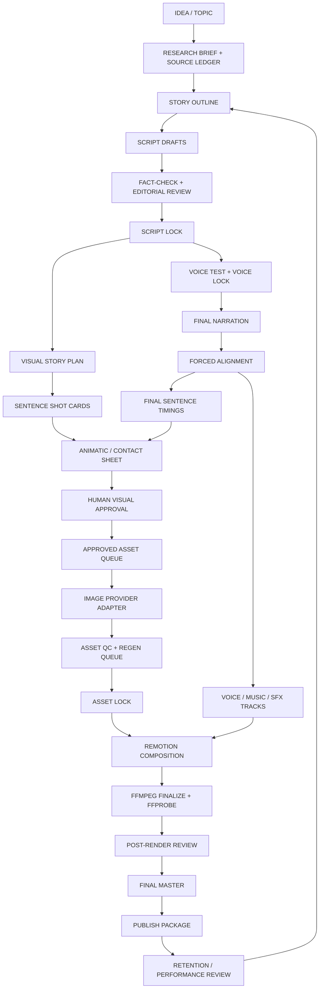

# OPENMONTAGE — VIDEO PRODUCTION FACTORY MASTER PLAN

**Документ:** архитектура производства и масштабирования образовательных animated-science-documentary выпусков  
**Версия:** 1.0  
**Дата исследования:** 2 ноября 2026 г.  
**Главный формат:** англоязычные научные видео на 20–25 минут, 16:9  
**Главный творческий ориентир:** Kurzgesagt — In a Nutshell (принципы производства и визуального повествования; не копировать их конкретный стиль, персонажей, композиции, тексты или активы)  
**Главный технический проект:** существующий OpenMontage в `/workspaces/OpenMontage`  
**Генерация изображений:** Google Flow через изолированный адаптер `gflow-cli`; Nano Banana — основной кандидат после проверки локальной версии и доступных режимов  
**Рендер:** существующий Remotion-композер, если локальный аудит подтвердит его пригодность; FFmpeg — медиапроцессинг и финальная проверка  
**Ключевое правило канала:** **ОДНО ПРЕДЛОЖЕНИЕ = ОДИН УНИКАЛЬНЫЙ ПРОМПТ = ОДНО УНИКАЛЬНОЕ ФИНАЛЬНОЕ ИЗОБРАЖЕНИЕ.**

---

# 0. Назначение и правила применения документа

Этот документ — технический и производственный мастер-план будущей видеофабрики OpenMontage. Он описывает, **как должен быть устроен процесс**, какие решения принимаются на каждом этапе, какие инструменты использовать, как проверять результат и как безопасно перейти от первого пилота к повторяемому производству.

Документ не является разрешением на генерацию, расходование кредитов, изменение браузерной авторизации или отключение защитных механизмов. Он не требует немедленно переписывать проект. Перед внедрением Kilo обязан провести аудит фактического локального состояния репозитория.

## 0.1. Жёсткие ограничения

1. Не отключать `--no-spend`, MCP Security Proxy, Flow Job Manager и существующие approval gates.
2. Не запускать реальные генерации Nano Banana/Veo без отдельного явного разрешения владельца проекта.
3. Не менять авторизацию Google Flow, профили Chrome, CDP-порты и существующую схему входа без отдельной задачи.
4. Не обновлять `gflow-cli`, Remotion, FFmpeg, Python или Node только потому, что вышла новая версия. Сначала зафиксировать текущую версию, проверить changelog, лицензии и регрессионные тесты.
5. Не удалять и не заменять работающие модули без сравнительного теста и доказательства выигрыша.
6. Не выдавать неподтверждённые команды, параметры, модели, цены и лимиты за проверенные.
7. Не генерировать текст, подписи, формулы или мелкие научные метки внутри AI-картинки. Текст и диаграммные подписи добавлять программно на этапе графики/композиции.
8. Не копировать защищённые творческие активы других каналов. Изучаем производственные принципы, но создаём собственный бренд.
9. Не представлять ролик, состоящий из неподвижных картинок с минимальным зумом, как полноценную анимацию. Каждый кадр должен иметь запланированную визуальную функцию и осмысленное движение.
10. Каждое предложение сценария должно иметь отдельный уникальный визуальный актив. Исключения допустимы только после явного изменения владельцем правила канала.

## 0.2. Иерархия требований

При конфликте требований приоритет следующий:

1. Фактическая и научная корректность.
2. Понятность для зрителя и соответствие теме предложения.
3. Сюжетная и визуальная целостность выпуска.
4. Собственная визуальная идентичность канала и постоянство персонажа.
5. Ритм, композиция, движение и качество звука.
6. Скорость и стоимость производства.

Нельзя жертвовать корректностью ради красивого кадра или ускорять выпуск ценой фальшивых доказательств.

---

# 1. Цель фабрики и её творческая модель

## 1.1. Что производим

OpenMontage должен уметь производить оригинальные образовательные научные документальные истории для англоязычного YouTube.

Основные направления:

- человеческая биология и эволюция;
- происхождение и развитие жизни;
- животные, экосистемы и необычные биологические адаптации;
- космос, планеты и астрофизика;
- микромир, клетки, молекулы и биохимия;
- физика, технологии и научные открытия;
- научно обоснованные мысленные эксперименты и speculative biology как отдельные эпизоды, а не единственная тема канала.

Один выпуск — один главный вопрос, одна линия повествования и один понятный вывод. Это не подборка случайных фактов и не длинная школьная лекция.

## 1.2. Референсы по производству

Главный ориентир — Kurzgesagt. Важно перенять не внешнее копирование, а производственные принципы:

- глубокое исследование и опора на первоисточники;
- отдельный source sheet для выпуска;
- многократная редактура сценария;
- поиск визуальных метафор до создания финальных иллюстраций;
- озвучка как временная основа анимации;
- сочетание 2D, 2.5D и точечных 3D-элементов;
- отдельная музыкальная и звуковая драматургия.

Дополнительные референсы:

- TED-Ed — отдельная визуальная идея на каждую историю, разнообразие художественных решений и кинематографические сцены;
- MinuteEarth — ясное объяснение сложных процессов простыми визуальными метафорами;
- TierZoo — запоминающаяся рамка повествования и последовательное использование концепта;
- AsapSCIENCE — доступность языка, чувство юмора и понятные аналогии;
- Vox / video essay production — редакционная структура, визуальные доказательства, карты, графики, архивные и контекстные материалы.

Референсы — только ориентиры. Не использовать чужих персонажей, логотипы, фирменных существ, музыку, сценарии, точные раскадровки и узнаваемые готовые композиции.

## 1.3. Главный персонаж канала

Персонаж — молодой исследователь с тёмными слегка растрёпанными волосами, круглыми очками, светлой рубашкой и тёмными брюками. Его функция — вести зрителя по теме, задавать вопросы, представлять переходы и помогать понять сложный материал.

Он не должен быть «говорящей головой» во всех кадрах. Он появляется, когда это усиливает рассказ: открытие темы, переход к следующему разделу, демонстрация масштаба, реакция на неожиданное открытие, визуализация гипотезы и финальный вывод.

Его визуальная идентичность должна храниться в отдельном наборе официальных референсов:

- нейтральный фронтальный вид;
- профиль и 3/4;
- полный рост;
- выражения лица;
- основные позы и жесты;
- одежда и аксессуары;
- цветовая палитра;
- запрещённые изменения анатомии, лица, очков, причёски и одежды.

Не считать один удачный портрет достаточным character bible. Нужен одобренный reference pack, проверенный на нескольких разных сценах.

---

# 2. Исследование профессиональных производственных процессов

## 2.1. Что важно у Kurzgesagt

Публичное описание процесса Kurzgesagt показывает последовательность, в которой исследование предшествует сценарию; сценарий многократно редактируется; визуальные метафоры и идеи сцен рассматриваются до финальной иллюстрации; озвучка задаёт тайминг анимации; музыкальное и звуковое оформление создаёт эмоциональный контекст.

Из этого следует обязательное правило для нашей фабрики: **сначала фиксируется научная история, затем визуальная драматургия, затем озвучка и только потом массовое производство иллюстраций и монтаж**. Не начинать массовую генерацию по сырому сценарию.

## 2.2. Что важно в редакционном video essay

Сильный научный video essay обычно строится вокруг вопроса, а не вокруг последовательности поисковых запросов. Редактор должен уметь ответить:

- Что зритель узнает к концу?
- Почему этот вопрос интересен именно сейчас или почему он неожиданен?
- Что зритель уже знает неправильно или неполно?
- Какие доказательства будут менять его представление?
- Какое визуальное доказательство лучше абзаца текста?
- Где нужен реальный научный график, а где допустима метафора?
- Что удержит внимание после первых 30 секунд?

Фабрика должна создавать логический переход между фактами, а не только генерировать сцены по очереди.

## 2.3. Что важно в анимационной студийной схеме

Профессиональный производственный процесс отделяет этапы, которые в любительской AI-сборке часто смешиваются:

1. исследовательский brief;
2. сценарий и редактура;
3. визуальный концепт и style frames;
4. storyboard;
5. animatic с временным звуком;
6. production assets;
7. анимация и compositing;
8. music / sound design;
9. монтаж и финальный mix;
10. технический и редакционный QC;
11. delivery и архив проекта.

OpenMontage должен сохранить эти различия даже при автоматизации. Если агент перескакивает от одного текста сразу к сотням изображений, он пропускает критические творческие проверки.

## 2.4. Принципы YouTube-подачи

Первое полминуты должно подтверждать обещание названия и обложки и сразу показывать, почему тема интересна. После публикации нужно изучать удержание аудитории: intro percentage, spikes, dips и наиболее устойчивые участки. Эти данные должны возвращаться в редакторскую базу для следующих сценариев.

Не задавать искусственный темп «новый визуал каждую секунду». Темп зависит от смысла, сложности объяснения и длины предложения. Цель — ясность и интерес, не механическая частота смены кадров.

---

# 3. Рекомендуемая архитектура: гибридный детерминированный конвейер + AI-агент

## 3.1. Главный архитектурный принцип

Использовать гибридную модель:

- AI-агент принимает творческие решения, исследует, пишет, проектирует storyboard, объясняет ошибки и предлагает варианты;
- Python-оркестратор управляет состояниями, очередями, файлами, повторными попытками, проверками и журналом;
- внешние генераторы работают через адаптеры;
- Remotion создаёт воспроизводимую покадровую композицию;
- FFmpeg выполняет надёжные операции с аудио/видео и техническую проверку;
- человек утверждает творческие контрольные точки и все расходы/необратимые действия.

Не делать AI-агента единственным владельцем состояния проекта. Контекст разговора не является надёжной базой данных. Любая длительная операция должна возобновляться из файлового манифеста/SQLite после отключения Codespace или остановки агента.

## 3.2. Архитектурные слои

| Слой | Обязанность | Источник правды |
|---|---|---|
| Creative Brain | идея, исследование, сценарий, метафоры, review | документы эпизода + агент |
| Production Orchestrator | state machine, dependency graph, retries, approvals | SQLite + JSON manifests |
| Provider Adapters | Flow, TTS, alignment, music, enhancement | адаптеры и capability registry |
| Asset Registry | изображения, звук, графики, версии, лицензии, hashes | manifest + файловая система |
| Editorial Timeline | sentence/shot timing, tracks, transitions, markers | canonical timeline JSON; OTIO export при необходимости |
| Renderer | анимация сцен, титры, композиция | Remotion project |
| Media Engine | транскодирование, нормализация, mux, probes | FFmpeg / ffprobe |
| Quality System | факт-чек, художественный QC, технический QC | отчёты и quality gates |
| Human Review | approvals и обратная связь | approval records |
| Analytics Feedback | retention, CTR, comments, lessons learned | episode postmortem |

## 3.3. Схема конвейера



## 3.4. Рекомендуемые стадии и state machine

Минимальная state machine эпизода:

`IDEA → RESEARCHING → RESEARCH_REVIEW → OUTLINE → SCRIPT_DRAFT → FACT_CHECK → SCRIPT_LOCKED → VOICE_TEST → VOICE_LOCKED → NARRATION_READY → ALIGNMENT_READY → STORYBOARD → ANIMATIC → VISUAL_APPROVAL → ASSET_PLANNING → READY_FOR_APPROVAL → GENERATING → ASSET_QC → ASSETS_LOCKED → EDIT_PLAN → ROUGH_CUT → EDITORIAL_REVIEW → FINAL_RENDER → TECH_QC → FINAL_APPROVAL → PUBLISH_READY → PUBLISHED`

Дополнительные конечные состояния: `BLOCKED`, `FAILED`, `CANCELLED`, `NEEDS_REVISION`.

Каждый переход должен:

- проверять обязательные входные артефакты;
- записывать timestamp, actor, version и причину;
- сохранять snapshot манифеста;
- делать операцию idempotent там, где это возможно;
- не перескакивать через approval gate;
- поддерживать resume после сбоя;
- фиксировать расход кредитов, API cost и время выполнения.

Реальное внешнее изображение допускается только из `READY_FOR_APPROVAL` после явного `APPROVED`. Для финансово затратной видеогенерации Veo требуется отдельное подтверждение на соответствующий job/batch.

---

# 4. Оценка существующих инструментов и что менять

## 4.1. Общее решение

**Не заменять текущий стек целиком.** В публичной архитектуре OpenMontage уже описаны pipeline manifests, stage-director skills, Python tools, JSON schemas, visual style playbooks, Remotion composer и quality gates; пользовательский проект дополнительно имеет ранее созданные модули препродакшна и Flow Job Manager. Правильный путь — проверить локальные реализации и закрыть пробелы.

Каждый инструмент проходит scorecard по семи измерениям:

1. соответствие задаче;
2. художественное/техническое качество;
3. контроль и возможность повторить результат;
4. надёжность и воспроизводимость;
5. стоимость и лицензия;
6. latency/скорость;
7. интеграция и переносимость.

Не менять инструмент по одному впечатлению от демо. На пилоте сравнивать на одном и том же коротком тестовом наборе.

## 4.2. Матрица рекомендуемого стека

| Задача | Основной кандидат | Резерв / кандидат на тест | Решение |
|---|---|---|---|
| Оркестрация | существующий Flow Job Manager + новый episode orchestrator | простая Python state machine с SQLite | Сохранить и расширить; не переносить бизнес-логику в shell-скрипты |
| Креативные решения | Kilo/LLM как агент по stage skills | ручное утверждение | Оставить агентом, но не доверять ему единолично state или retry policy |
| Изображения | Nano Banana через gflow adapter | другая легально разрешённая модель через тот же интерфейс | Сначала тест качества; не зашивать модель напрямую в renderer |
| Управление Flow | установленный gflow-cli | официальный Gemini API, если появится отдельный ключ и разрешение | Пока оставить gflow-cli; изолировать из-за alpha/private UI automation |
| Таймлайн/композиция | Remotion, если локальный проект уже использует его | FFmpeg для простого assembly; Blender для отдельных 3D shot | Remotion — основной renderer; FFmpeg — постобработка |
| Векторные сцены | SVG/React/Canvas внутри Remotion | Blender Grease Pencil для hand-drawn/2D сложных сцен | Сначала SVG/React; Blender только при конкретной потребности |
| TTS | текущий провайдер после voice bake-off | Kokoro-82M (Apache 2.0 weights), затем Piper (GPL-3.0 engine) | Не менять до сравнения voice quality/pronunciation/consistency |
| Forced alignment | WhisperX | faster-whisper + отдельный aligner | Протестировать WhisperX на длинной английской озвучке |
| Audio/video utilities | FFmpeg + ffprobe | native Remotion APIs | Оставить; это основа media validation |
| Timeline interchange | internal canonical JSON | OpenTimelineIO export/import | OTIO опционально для DaVinci/editor handoff |
| Manual finishing | DaVinci Resolve optional | Blender VSE | Не обязателен для автономной фабрики |
| Analytics | YouTube Studio manual export | API connectors later | На пилоте сохранять показатели вручную |

## 4.3. gflow-cli: использовать, но не делать single point of failure

`gflow-cli` — сторонний неофициальный alpha-проект, который управляет Google Flow через автоматизацию браузера Chromium/Playwright и интерфейс/внутренний протокол Flow. Это удобно для уже существующей авторизованной среды, но означает зависимость от Google UI, сессий, CAPTCHA, изменений frontend и совместимости версии CLI.

Требования:

- только один provider adapter внутри OpenMontage;
- все вызовы через безопасный subprocess/API интерфейс адаптера;
- не обращаться из разных модулей прямо к `gflow` командам;
- capability discovery при старте: локальная версия, команды, параметры, transport, доступные image/video modes;
- не считать возможности текущего upstream README автоматически доступными в локальном `0.92.0`;
- перед обновлением — snapshot текущей версии, mock regression, changelog, rollback plan;
- один активный browser generation worker, пока нагрузочные тесты не докажут безопасную concurrency;
- записывать command, sanitized args, job ID, provider, model alias, project ID, output path, status, retry count, elapsed time и cost/credit snapshot;
- never silently resubmit after timeout; сначала проверить Flow project/catalog/history и dedupe state;
- preserve `--no-spend` и MCP boundary; запретные инструменты не должны быть доступны агенту без approval.

В текущей публичной документации gflow-cli описаны T2I/I2I, batch, upload, upscale, character, T2V/I2V/R2V, chain/extend, movie manifests, prompt tools и MCP. Для новой Flow frontend migration документация также указывает Nano Banana 2.1 (`nano2`), 2 Lite и Pro, но конкретные параметры/ratio/count ограничены доступными возможностями данного Flow host. Это **не подтверждает**, что все пункты доступны в установленном у пользователя `0.92.0`. Kilo должен проверить help/installed package/changelog до реализации.

Отдельно: upstream README сообщает, что изображения и composition operations не расходуют Veo credits, а Veo video generation расходует; однако в пользовательском аккаунте и текущем UI нужно проверять фактический баланс/учёт до любого платного действия. Не выводить стоимость из README или счётчика без live verification.

## 4.4. Nano Banana: роль в фабрике

Nano Banana 2.1 — сильный кандидат на основной генератор высококачественных изображений и conversational image editing. В официальной документации Gemini API заявлены разрешения 1K/2K/4K, multi-image fusion до 14 референсов, включая до 4 изображений персонажей и до 10 объектов; это возможности Gemini API, а не автоматическая гарантия того же набора в Google Flow или в локальном gflow-cli.

Нельзя смешивать три разных уровня:

1. модель/возможности Nano Banana в Gemini API;
2. функции Google Flow UI и доступные конкретному аккаунту;
3. функции и ограничения локальной версии gflow-cli.

Архитектура должна поддерживать model alias/capabilities, а не жёстко вшивать название в промпты. Для пилота:

- использовать 16:9;
- генерировать по одному отдельному prompt на каждое предложение;
- character reference pack подключать только к тем кадрам, где нужен ведущий;
- использовать style reference/asset reference по доступному интерфейсу;
- не предполагать, что модель всегда выполнит точное количество/положение объектов;
- проверять финальные изображения вручную на pilot и автоматически на всех последующих партиях;
- сохранять исходный prompt, model ID/alias, reference IDs, provider request, результат, metadata и hash.

## 4.5. Remotion, FFmpeg, Blender и DaVinci Resolve

### Remotion — основной renderer

Для этого канала Remotion подходит лучше всего как primary composition engine: ролики собираются из повторно используемых React-компонентов, SVG-графики, keyframes, camera transforms, captions, diagrams, audio layers и scene templates. Он поддерживает frame-accurate render, parameterized templates, captions, effects, transitions, server-side rendering и batch rendering.

Проверить лицензию: Remotion указывает бесплатную лицензию для individuals и компаний до 3 человек, включая commercial use; отдельный план `Remotion for Automators` относится к использованию для автоматизированных video products/services и имеет отдельную модель оплаты. Kilo должен прочитать действующие LICENSE/terms и классифицировать конкретный use case до коммерческого запуска.

### FFmpeg — оставить как обязательный media engine

Использовать для:

- извлечения и конвертации аудио;
- подготовки voice/music/SFX stems;
- ресэмплинга и нормализации звука;
- кодирования final master;
- muxing subtitles/captions при необходимости;
- технических probes и извлечения контрольных кадров;
- создания proxy/preview media.

Не заставлять FFmpeg делать сложную сценическую анимацию, которую легче и надёжнее кодировать в Remotion.

### Blender — вспомогательный инструмент, не замена Remotion

Blender полезен для отдельных 3D сцен, объёмных научных моделей, 2.5D camera moves, Grease Pencil или сложного compositing. Но он добавляет отдельные файлы проектов, ресурсы, настройку рендера и более высокий порог автоматизации. Не использовать Blender как основной renderer для каждого предложения.

### DaVinci Resolve — необязательный ручной finishing desk

Может пригодиться, если позже нужен ручной профессиональный review, цвет/звук и монтаж. Но текущая цель — автоматическая фабрика из Codespaces; Resolve не должен быть обязательной зависимостью. Достаточно экспортировать master и при необходимости timeline interchange.

### OpenTimelineIO — optional interoperability layer

Если нужно переносить монтаж между Remotion и desktop NLE, можно добавить экспорт OTIO. OTIO хранит editorial cut information — клипы, тайминг, треки, переходы, markers и ссылки на медиа, но не встраивает сами аудио/видео-файлы. Не заменять им наш полный Episode Manifest.

## 4.6. TTS и синхронизация

TTS оценивается не только по «приятному голосу». Важны:

- естественное повествование на 20 минут;
- стабильный тембр от начала до конца;
- правильное произношение научных имён и терминов;
- управляемые паузы и ударения;
- возможность одинаково пересоздать исправленный фрагмент;
- коммерческие права на модель, код, голос и результат;
- скорость и доступность в среде Codespaces/Kaggle.

Kokoro-82M — перспективный кандидат для A/B-теста: model card указывает open weights с Apache-2.0 и относительно компактную модель. Проверять отдельно зависимости, выбранный voice pack и применимую лицензию. Piper в актуальном проекте OHF-Voice имеет GPL-3.0 engine; voice model licenses проверяются отдельно. Не путать старый архивный `rhasspy/piper` с текущим поддерживаемым проектом.

Рекомендуемая система:

1. выбрать 2–3 допустимых голоса;
2. сгенерировать одинаковый 60–90 секундный тестовый текст с именами, числами и сложными терминами;
3. слушать blind A/B и оценивать естественность, дикцию, усталость, акценты и паузы;
4. зафиксировать один voice profile для пилота;
5. генерировать длинную озвучку большими смысловыми блоками/абзацами, а не каждое предложение отдельно, чтобы не ломать интонацию;
6. выполнить forced alignment финального аудиофайла по утверждённому тексту;
7. получить word-level timings и агрегировать их до sentence-level intervals.

WhisperX — основной кандидат для word-level timestamps и forced alignment; его README описывает wav2vec2 alignment, batched inference и faster-whisper backend. Для одного диктора diarization не обязательна. Если WhisperX слишком тяжёлый/ломкий в текущем окружении, benchmark faster-whisper плюс отдельный aligner.

**Критически важно:** после исправления текста нельзя продолжать использовать старые тайминги. Новый voice render → новый alignment → новое timeline manifest.

---

# 5. Контентное производство: от идеи до Script Lock

## 5.1. Research brief

Создаётся документ `research/RESEARCH_BRIEF.md` и машинно-читаемый `research/source_ledger.json`.

Каждое утверждение/цифра получают ID и поля:

- `claim_id`;
- точная формулировка;
- тип: `MEASURED`, `ESTIMATE`, `UNKNOWN`, `INTERPRETATION`;
- источник и точная URL/DOI;
- организация/автор;
- дата публикации и дата доступа;
- цитируемый фрагмент/страница/таблица;
- метод/выборка/ограничения;
- статус проверки;
- где утверждение используется в сценарии.

Порядок источников по надёжности:

1. первичные научные статьи и данные;
2. systematic reviews/meta-analyses и признанные научные организации;
3. университетские материалы и экспертные объяснения;
4. надёжные научные издания для контекста;
5. форумы/соцсети — только для выявления вопросов аудитории, не как доказательство факта.

Каждый ключевой claim должен подтверждаться надёжным источником. Если доказательства спорные, показать неопределённость в сценарии. Не подменять научное исследование «AI search summary».

## 5.2. Topic / proposal gate

Для каждой идеи создать одностраничный proposal:

- центральный вопрос;
- обещание зрителю;
- кому интересна тема;
- что в ней неожиданного;
- почему это можно объяснить визуально;
- основные доказательства;
- потенциальные ошибки/риски;
- конкурирующие видео/подходы;
- уникальный угол канала;
- предварительная структура на 20 минут.

Не начинать полный script, пока proposal не выбран.

## 5.3. Сценарий

Ориентир для 20 минут — примерно 2 600–3 000 английских слов при темпе порядка 130–150 слов/мин. Это стартовый диапазон, не фиксированный KPI. Реальная продолжительность определяется финальной озвучкой, паузами и драматургией.

Сценарий должен иметь:

- opening hook;
- центральный вопрос;
- зрительскую ставку/почему это важно;
- 4–6 логических актов;
- progression: каждый акт добавляет новое понимание;
- 2–3 запоминающихся визуальных метафоры;
- минимум один понятный повтор/возврат к начальной загадке;
- финальный вывод без пустой морали;
- source references для каждого фактического утверждения.

Редактура должна удалить повторения, filler и слишком сложные конструкции. Не растягивать ролик ради достижения 20 минут: сначала добиться полноценной истории, затем измерить длину voice track.

## 5.4. Fact-check и Script Lock

Перед Script Lock:

- каждое число проверено;
- терминология согласована;
- причинно-следственные связи не преувеличены;
- метафоры не подменяют факты;
- оценки маркированы как оценки;
- сценарий не содержит неразрешённых claim gaps;
- все источники сохранены.

После `SCRIPT_LOCKED` текст нельзя незаметно менять. Любое изменение создает новую версию сценария и инвалидирует затронутые sentence IDs, prompts, voice timings и assets.

---

# 6. Audio-first timing и правило одного изображения на предложение

## 6.1. Основной принцип

**Одно предложение = один unique sentence ID = один отдельный prompt = один уникальный final image asset.**

Пример:

- `S0001` — The ocean covers most of our planet. → `S0001.png`
- `S0002` — But its deepest regions remain mysterious. → `S0002.png`
- `S0003` — Sunlight cannot reach these depths. → `S0003.png`

Нельзя прикреплять одну и ту же финальную картинку к двум разным sentence IDs. Повторная генерация для исправления одного предложения заменяет его версию/asset, но не создаёт дублирующий ID.

## 6.2. Sentence segmentation

Сегментация запускается только после Script Lock. Использовать LLM для подсказки границ можно, но финальная сегментация должна сохранять текст дословно и проверяться deterministic validator.

Обработать:

- сокращения (`Dr.`, `e.g.`, `U.S.`);
- десятичные числа и даты;
- инициалы и химические обозначения;
- цитаты;
- заголовки;
- длинные сложносочинённые предложения;
- предложения, разделённые эм-дэшами;
- abbreviations в научной терминологии.

Для каждого предложения создать стабильный `sentence_id`, `sentence_index`, `script_version`, `paragraph_id`, `act_id` и исходный text. ID не должен зависеть только от номера строки после косметической правки; нужно хранить content hash/version lineage.

## 6.3. Голос задаёт реальный тайминг

После выбора TTS и Voice Lock:

1. генерировать финальную narration;
2. сохранить WAV master и compressed preview;
3. прогнать forced alignment;
4. получить timestamps каждого слова;
5. агрегировать в sentence start/end;
6. проверить вручную границы длинных предложений, паузы и сложные термины;
7. создать timeline clock в integer frames, не округлять на каждом этапе в float seconds.

Рекомендуемая частота кадра: выбрать один профиль для всего канала (например, 30 fps для motion-heavy 2D explainers) и сохранить его в episode manifest. Если исходные инструменты требуют другой частоты, документировать решение. Перевод секунд в кадры должен выполняться один раз в canonical timeline.

## 6.4. Sentence timing schema

У каждой sentence card должны быть:

- `sentence_id`;
- `text`;
- `word_start_index`, `word_end_index`;
- `start_ms`, `end_ms`;
- `start_frame`, `end_frame`;
- `duration_ms`;
- `voice_segment_id`;
- `alignment_confidence`;
- `manual_timing_override`;
- `visual_prompt_id`;
- `image_asset_id`;
- `shot_id`.

Время каждого кадра берётся из voice alignment. Не делить 20 минут на равные части и не давать каждому изображению одинаковые 6 секунд.

## 6.5. Как избежать однообразного слайд-шоу

Правило уникального изображения не означает, что каждый кадр должен иметь одинаковый эффект Ken Burns. Каждый sentence card получает одну из осмысленных motion grammars:

- `CAMERA_PUSH` — медленное приближение к ключевому объекту;
- `CAMERA_PULL` — отдаление, раскрывающее масштаб;
- `LATERAL_REVEAL` — боковое раскрытие;
- `DEPTH_PARALLAX` — 2.5D разнесение переднего/среднего/заднего планов;
- `OBJECT_ORBIT` — имитация орбитального движения вокруг научного объекта;
- `DIAGRAM_REVEAL` — поэтапное появление схемы/подписей;
- `MECHANISM_FLOW` — поток частиц/маркеров по заранее проверенной траектории;
- `MATCH_CUT` — переход по форме, цвету или масштабу;
- `CHARACTER_ACTION` — жест/поза ведущего;
- `HOLD_WITH_MICRO_MOTION` — короткая визуальная пауза с едва заметным движением;
- `SPLIT_COMPARISON` — программно построенное сравнение;
- `CUTAWAY_REVEAL` — раскрытие внутреннего устройства объекта.

Одна и та же motion grammar не должна бесконечно повторяться. Использовать движение только для усиления смысла; не добавлять хаотичные эффекты ради активности.

---

# 7. Визуальная фабрика: storyboard → prompts → images → QC

## 7.1. Shot card до генерации

Каждое предложение сначала превращается в Shot Card. В ней фиксируются:

- sentence ID и акт;
- точная идея кадра (одна главная мысль);
- что зритель должен понять за эти секунды;
- тип visual evidence: factual visualization / explanatory diagram / metaphor / environment / character beat / reconstruction;
- главный субъект;
- окружение;
- масштаб и перспектива;
- план: wide / medium / close-up / macro / cross-section;
- композиция и negative space;
- палитра и lighting;
- нужен ли ведущий и какой character reference использовать;
- камера и motion grammar;
- нужно ли разделение на слои;
- научные элементы, которые обязаны быть правильными;
- что запрещено показывать;
- переход из предыдущего кадра и в следующий;
- источники, если кадр изображает конкретный факт/объект.

Сначала создать storyboard для всех предложений. Затем собрать contact sheet и пройти человеческое одобрение визуальной последовательности. Это дешевле, чем исправлять 200 неверных изображений.

## 7.2. Prompt template

Промпт разделяется на структурные компоненты, а не пишется как случайный длинный абзац:

1. `CHANNEL_STYLE`: фиксированный стиль из MASTER_VISUAL_STYLE_GUIDE;
2. `SHOT_INTENT`: что должен понять зритель;
3. `SUBJECT`: конкретный предмет изображения;
4. `SCIENTIFIC_CONTEXT`: точность и ограничения;
5. `ACTION_OR_STATE`: что именно происходит;
6. `ENVIRONMENT`: контекст;
7. `COMPOSITION`: главный объект, пространство, фокус;
8. `CAMERA`: план и угол;
9. `COLOR_LIGHT`: палитра и освещение;
10. `CHARACTER_REFERENCES`: только когда персонаж нужен;
11. `CONTINUITY`: как кадр связан с другими сценами;
12. `NEGATIVE_CONSTRAINTS`: без текста, случайных букв, логотипов, watermark, лишних частей, несоответствий анатомии.

Промпт обязан описывать один ясный визуальный момент. Не просить одну AI-картинку одновременно изобразить 4 последовательных события или целую инфографику из множества подписей.

## 7.3. Reference packs

Подготовить:

- global style reference pack;
- character reference pack;
- recurring prop/reference pack;
- chapter-specific references при необходимости;
- scientific ground truth references для уникальных видов/объектов.

Nano Banana 2.1 в Gemini API документирует до 14 изображений-референсов в одном вызове, с отдельными лимитами на персонажей и объекты. Но Flow и gflow-cli могут иметь иной предел. Адаптер должен отправлять только то количество и тип референсов, которое подтверждено для локального provider capability.

Не отправлять полный пакет из 14 изображений каждому кадру без причины. Это повышает неоднозначность и может снижать контроль. Использовать минимально достаточный набор: style + 1–4 character/reference assets, в зависимости от кадра и подтверждённого лимита.

## 7.4. Prompt review до генерации

Prompt validator проверяет:

- соответствует ли prompt одному предложению;
- не выдумывает ли он научную деталь;
- не противоречит ли style bible;
- не просит ли текст, который нужно добавить программно;
- правильно ли применены character references;
- нет ли повторения предыдущих двух-трёх кадров по композиции;
- не слишком ли много смысловых объектов;
- есть ли ясный visual focus;
- соответствует ли кадр таймингу и shot type.

Промпты должны проходить review перед попаданием в Flow queue.

## 7.5. Generation queue

- Один sentence prompt = отдельный generation job.
- `--count`/варианты для одного prompt не заменяют независимые уникальные prompts для разных предложений.
- Batch — это транспортная упаковка множества разных jobs; batch не меняет индивидуальный ID каждого задания.
- Размер batch выбирается из реального `gflow --help`/версии и тестов. Не жёстко вшивать лимит 50 или любой другой без подтверждения.
- На старте — один браузерный worker/последовательная отправка, если локальные тесты не доказали безопасную параллельность.
- Сохранять job record **до** отправки.
- При timeout сначала проверять статус/историю/каталог, а не посылать повторно.
- Retry использует тот же `sentence_id`, новый `attempt_id`, причину и сохранённый prompt.
- Успех подтверждается не сообщением CLI, а наличием файла, корректным MIME/размером, открытием/декодированием изображения и записью metadata.

## 7.6. Image QC

Автоматически:

- файл существует, декодируется, не пустой;
- aspect ratio соответствует 16:9 или профилю;
- минимальное разрешение и формат соответствуют требованиям;
- уникальный content hash;
- perceptual hash / image embedding для поиска почти-дубликатов;
- нет повреждённых/частично записанных файлов;
- проверка наличия текстовых артефактов/водяных знаков, если доступна надёжная модель;
- визуальное соответствие промпту через vision review как advisory, не единственный критерий;
- character consistency score, если персонаж должен быть в кадре;
- композиция оставляет необходимое пространство для безопасной зоны UI/subtitles;
- нет запрещённых/неуместных визуальных деталей.

Человек:

- просматривает contact sheets по сценам;
- подтверждает научную анатомию/геометрию, где это важно;
- отклоняет generic/repetitive AI art;
- проверяет, что каждый кадр действительно объясняет предложение.

## 7.7. Asset registry

Каждый финальный image asset получает запись:

`asset_id`, `episode_id`, `sentence_id`, `prompt_id`, `provider`, `model`, `model_version`, `request_id`, `attempt`, `reference_ids`, `created_at`, `file_path`, `sha256`, `pHash`, `width`, `height`, `mime_type`, `approval_status`, `qc_report`, `license/terms_snapshot`, `cost_record`.

Сохранять исходную генерацию отдельно от производных кропов, апскейлов и слоёв. Ничего не перезаписывать без версии.

---

# 8. Motion design и scene composition

## 8.1. Как один image превращается в осмысленный motion shot

У каждой sentence image есть минимум один planned motion behavior. Для простых сцен достаточно мягкого движения камеры. Для важных сцен создать более сложную композицию:

- разнести персонажа/объект/фон на слои, если это возможно без разрушения иллюстрации;
- использовать masks/segmentation, где качество контролируется;
- анимировать SVG-линии, стрелки, scale markers, labels и data callouts в Remotion;
- использовать depth illusion и camera transforms;
- выделять объект светом, обводкой или цветом;
- применять переходы match cut между related visual concepts;
- иногда удерживать кадр почти неподвижным, если зрителю нужно рассмотреть сложную схему.

Не создавать обязательную искусственную 2.5D сегментацию каждого изображения. Слойная обработка нужна только когда это визуально оправдано и не ухудшает края объекта.

## 8.2. Scene templates

Сделать библиотеку reusable Remotion components:

- `IllustrationShot` — AI illustration + camera animation;
- `ParallaxShot` — layered image + depth movement;
- `CharacterBeat` — ведущий с позой/выражением;
- `ScientificDiagram` — SVG diagram, labels, callouts;
- `ScaleComparison` — сравнение объектов/масштабов;
- `TimelineSequence` — историческая последовательность;
- `MapSequence` — географическое объяснение;
- `MacroMicroZoom` — переход между масштабами;
- `MechanismAnimation` — физический/биологический механизм;
- `DataVisualization` — charts с версионированными данными;
- `QuoteSourceCard` — короткая ссылка/цитата для экранного источника при необходимости;
- `TransitionBridge` — переход, мотивирующий связь сцен.

Все компоненты должны иметь фиксированный design system, safe areas, fps handling, deterministic props и тестовые previews.

## 8.3. Camera/motion limits

Избегать:

- одинакового zoom-in на каждом кадре;
- непрерывного случайного дрожания;
- слишком быстрых панорам;
- движения текста, мешающего чтению;
- неестественного parallax на объектах, которые должны быть плоскими;
- переходов ради самого перехода.

Для каждого shot сохранить motion intensity: `none / subtle / medium / strong`, а также начало/конец движения. Сильные движения оставлять для открытия, масштабных reveal и сюжетных кульминаций.

---

# 9. Audio production

## 9.1. Voice bible

Зафиксировать:

- голос/voice ID и разрешённый способ использования;
- акцент и темп;
- tonal direction (curious, clear, warm, credible; не чрезмерно рекламный);
- произношение научных терминов;
- dictionary/pronunciation overrides;
- формат и sample rate master WAV;
- процесс пересоздания изменённых абзацев.

Не клонировать чужой/реальный голос без разрешения. Не подделывать голос известного ведущего.

## 9.2. Narration pipeline

1. script locked;
2. pronunciation dictionary создан;
3. voice sample approved;
4. chunk planning по абзацам и смысловым блокам;
5. TTS generation;
6. chunk concatenation с контролем пауз и громкости;
7. pronunciation audit;
8. human listen-through;
9. final narration master;
10. forced alignment.

При изменении одного абзаца нужно сохранить стабильные IDs, но пересчитать timings всех затронутых sentence cards и continuity на стыках.

## 9.3. Music и SFX

Музыка должна поддерживать драматургию, а не звучать одинаковым фоном 20 минут.

Разбить выпуск на 4–6 музыкальных дуг: intro, discovery, explanation, tension/turn, implications, conclusion. Переходы сделать мягкими. Для каждого файла сохранить источник, лицензию, дату, attribution requirements и возможность использования в монетизируемом видео.

SFX добавлять только для обозначения действия/перехода: мягкие whoosh, impacts, biological ambience, underwater/cosmic textures, UI-like scientific ticks. Не перекрывать диктора.

## 9.4. Audio QC

Проверить:

- нет клиппинга и неожиданного цифрового пика;
- речь разборчива на телефоне;
- музыка не маскирует речь;
- нет тишины/обрывов в середине фраз;
- loudness измерен и записан;
- true peak измерен;
- паузы осмысленны;
- stereo/mono формат выбран последовательно;
- audio duration согласуется с таймлайном.

Начальные технические цели для пилотного измерения: integrated loudness ориентировочно от −16 до −14 LUFS для stereo master и true peak не выше −1 dBTP. Это рабочая отправная точка, а не обещание стандарта YouTube; прослушать мастер на телефоне и в наушниках и откорректировать по измерениям.

---

# 10. Canonical data model и файловая структура

## 10.1. Не хранить проект только в памяти агента

Нужно иметь versioned files + SQLite. JSON/YAML дают читаемость, SQLite — состояние и индексы. Файлы изображений и звук не помещать в БД, только хранить пути, metadata и hashes.

## 10.2. Рекомендуемая структура эпизода

```text
projects/<episode_slug>/
├── episode.yaml
├── state.sqlite
├── 00_brief/
│   ├── proposal.md
│   └── audience_promise.md
├── 01_research/
│   ├── research_brief.md
│   ├── source_ledger.json
│   └── claim_check_report.md
├── 02_script/
│   ├── script_v001.md
│   ├── script_locked.md
│   ├── sentences.json
│   └── script_diff_log.json
├── 03_audio/
│   ├── voice_bible.yaml
│   ├── pronunciation_dictionary.yaml
│   ├── narration_draft/
│   ├── narration_master.wav
│   ├── alignment_words.json
│   ├── alignment_sentences.json
│   ├── music/
│   └── sfx/
├── 04_storyboard/
│   ├── visual_outline.md
│   ├── shot_cards.json
│   ├── contact_sheets/
│   └── animatic/
├── 05_assets/
│   ├── references/
│   ├── prompts/
│   ├── jobs/
│   ├── raw/
│   ├── approved/
│   ├── derivatives/
│   ├── rejected/
│   └── asset_registry.json
├── 06_edit/
│   ├── timeline.json
│   ├── edit_decisions.json
│   ├── remotion_props.json
│   └── previews/
├── 07_qc/
│   ├── research_qc.md
│   ├── script_qc.md
│   ├── asset_qc.json
│   ├── audio_qc.json
│   ├── pre_render_qc.json
│   └── post_render_qc.json
├── 08_renders/
│   ├── preview/
│   ├── review/
│   └── final/
└── 09_delivery/
    ├── thumbnail/
    ├── title_description.md
    ├── subtitles.srt
    ├── sources.md
    └── publish_checklist.md
```

## 10.3. Episode manifest — минимум полей

```yaml
episode_id: EP0001
slug: example-science-question
status: IDEA
script_version: 0
visual_style_version: 1
character_bible_version: 1
language: en
format:
  width: 1920
  height: 1080
  fps_num: 30
  fps_den: 1
  target_duration_sec: 1200
rules:
  one_sentence_one_unique_prompt: true
  one_sentence_one_unique_final_image: true
  generated_text_in_images: false
providers:
  image_provider: gflow_adapter
  image_model: pending_capability_check
  tts_provider: pending_voice_bakeoff
  alignment_provider: whisperx_candidate
  renderer: remotion
  media_engine: ffmpeg
approvals:
  research: pending
  script: pending
  voice: pending
  storyboard: pending
  generation: pending
  final_video: pending
```

Все provider и model fields должны быть заполнены реальными установленными и проверенными значениями при старте эпизода; `pending` — только template state.

## 10.4. Sentence/shot record example

```json
{
  "sentence_id": "S0001",
  "script_version": 1,
  "act_id": "ACT01",
  "paragraph_id": "P0001",
  "text": "The ocean covers most of our planet.",
  "claim_ids": ["C001"],
  "timing": {
    "start_ms": 0,
    "end_ms": 2450,
    "start_frame": 0,
    "end_frame": 74,
    "alignment_confidence": 0.96
  },
  "shot": {
    "shot_id": "SHOT_S0001",
    "visual_intent": "Establish the scale of Earth's oceans",
    "visual_type": "environment",
    "shot_size": "extreme_wide",
    "camera_move": "CAMERA_PULL",
    "motion_intensity": "subtle"
  },
  "visual": {
    "prompt_id": "PROMPT_S0001_V1",
    "prompt_version": 1,
    "asset_id": "IMG_S0001_V1",
    "final_image_path": "05_assets/approved/S0001.png",
    "sha256": "filled_after_generation",
    "status": "planned"
  }
}
```

Это схема-пример, не реальные данные пилота. В production JSON Schema должен валидировать обязательные поля и типы.

---

# 11. Проверка качества: gates до и после рендера

## 11.1. Quality gates

| Gate | Что проверяем | Условие прохождения |
|---|---|---|
| G0 Idea | тема и уникальный угол | proposal approved |
| G1 Research | claim coverage и source quality | нет критических неподтверждённых claims |
| G2 Script | narrative, clarity, duration | script locked |
| G3 Voice | голос и произношение | narration approved |
| G4 Storyboard | визуальная логика всех предложений | contact sheet + animatic approved |
| G5 Generation | кредиты и подтверждение | explicit approval recorded |
| G6 Assets | уникальность и пригодность файлов | все sentence IDs покрыты approved assets |
| G7 Timeline | sync, transitions, duration | все intervals валидны |
| G8 Pre-render | renderer promise, slideshow risk, resource availability | report PASS |
| G9 Post-render | video/audio technical QA | report PASS |
| G10 Final | human editorial review | final approval |

## 11.2. Asset coverage gate

Для любого финального ролика должно выполняться:

- количество sentence IDs равно количеству финальных image asset links;
- отсутствуют пустые sentence intervals;
- у каждого предложения ровно один approved final image;
- разные sentence IDs не ссылаются на одинаковый file path или одинаковый content hash;
- повторные попытки не создают лишние финальные assets;
- нет необъяснённых orphan images;
- нет неиспользуемых затратных активов без записи причины.

## 11.3. Slideshow-risk gate

Проверять шесть измерений:

1. повторяемость композиции;
2. декоративные визуалы без информационной функции;
3. слабое или механическое движение;
4. отсутствие намеренного shot design;
5. злоупотребление титрами/текстовыми карточками вместо визуального объяснения;
6. несоответствие заявленного стиля фактическому output.

Если risk score высокий, выпуск возвращается на storyboard/edit revision. Нельзя просто добавить ещё больше zoom эффектов.

## 11.4. Pre-render checks

- все файлы существуют и читаются;
- все asset dimensions и codecs валидны;
- все fonts и dependencies доступны;
- нет missing media;
- timeline frame numbers последовательны;
- total runtime совпадает с выбранным master timeline;
- есть нормальный audio track;
- нет пустых сцен;
- subtitles синхронизированы;
- есть диск/память для рендера;
- renderer выбран и его версия записана;
- render profile задан явно.

## 11.5. Post-render checks

Использовать `ffprobe` и frame extraction:

- контейнер/codec/resolution/fps/duration;
- audio stream exists and duration matches;
- нет black frames, frozen frames или повреждённого видео;
- нет случайных пустых участков;
- кадры из начала, четвертей, середины, конца и каждого перехода визуально проверены;
- loudness/true peak измерены;
- subtitles не вылезают за safe area;
- audio/video sync не дрейфует;
- итоговое соответствие one sentence–one image доказано по manifest.

Post-render QA не должен полагаться только на четыре случайных кадра: для длинного видео применять регулярную выборку кадров и автоматическую проверку всех transition boundaries.

---

# 12. Из чего должна состоять будущая Video Factory

Фабрика — не один гигантский скрипт, а набор небольших проверяемых сервисов/модулей.

## 12.1. Предлагаемые подсистемы

1. `episode_orchestrator` — state machine, task graph, checkpoint/resume.
2. `research_manager` — claims, sources, citations, fact-check status.
3. `script_manager` — drafts, locks, revisions, sentence segmentation.
4. `voice_manager` — TTS provider, pronunciation, chunking, voice master.
5. `alignment_manager` — word/sentence timings, timing review.
6. `storyboard_manager` — acts, beats, sentence shot cards, animatic.
7. `prompt_manager` — style template, references, prompt versions.
8. `provider_registry` — actual capability discovery and scorecards.
9. `gflow_adapter` — Flow operations and output persistence.
10. `asset_manager` — asset registry, content hashes, dedupe, contact sheets.
11. `asset_qc` — file and visual checks.
12. `motion_planner` — motion grammar and composition props.
13. `remotion_composer` — reusable shot components and episode timeline render.
14. `audio_mixer` — narration/music/SFX mastering.
15. `ffmpeg_finalize` — encode/mux/probe.
16. `quality_gate` — all pre/post gates.
17. `approval_manager` — signed/traceable user decisions.
18. `analytics_collector` — manual/API analytics and postmortem.

Названия — проектные рекомендации; перед созданием проверить, что аналогичные модули уже существуют.

## 12.2. Existing modules to preserve and integrate

На основании предыдущих отчётов в проекте уже создавались:

- `lib/script_analyzer.py`;
- `lib/scene_planner.py`;
- `lib/visual_director.py`;
- `lib/character_consistency_manager.py`;
- `lib/prompt_engineer.py`;
- `lib/quality_control.py`;
- `lib/flow_integration.py`;
- `lib/flow_job_manager.py`;
- тесты препродакшна, Flow Job Manager и mock/load tests.

Перед изменениями Kilo должен сверить фактические файлы и актуальный `PROJECT_STATE_HANDOFF.md`. Это список ранее отчитанных компонентов, а не гарантия того, что все они всё ещё присутствуют в текущей ветке.

## 12.3. Capability registry

Каждый tool/provider регистрирует:

- provider ID и installed version;
- task types (image, video, TTS, alignment, render, audio);
- model aliases;
- supported aspect ratios/resolutions;
- accepted input types;
- reference-image support and limits;
- batch size/parallelism limits;
- output formats and paths;
- authentication needs;
- credit/cost behavior (verified date/source);
- known limitations;
- license/terms URL;
- health status;
- last tested date and test result.

Provider selection выбирает лучший tool только среди реально доступных и разрешённых. Если текущий provider не умеет нужную функцию, pipeline должен остановиться с ясной ошибкой или предложить альтернативу, а не вызывать несуществующий параметр.

---

# 13. Pilot-first strategy: от теста до первого полного выпуска

Не начинать с 200 изображений. Первым делом проверить всю вертикальную цепочку на небольшом наборе. Затем сделать первый выпуск целиком. Только после postmortem строить повторяемую фабрику.

## Phase 0 — Local repository audit

**Цель:** установить, что реально готово в Codespace.

Kilo должен:

- прочитать `PROJECT_STATE_HANDOFF.md`, `MASTER_VISUAL_STYLE_GUIDE.md` и существующие guides;
- найти все модули и tests;
- зафиксировать `git status`, branch, commit, Python/Node/FFmpeg/Remotion/gflow versions;
- прочитать локальные CLI help и installed source;
- проверить реальные renderer paths;
- проверить license/terms каждой внешней зависимости;
- прогнать имеющиеся тесты без генерации;
- создать `docs/FACTORY_BASELINE_AUDIT.md`.

**Выход:** карта компонентов и список пробелов; никаких реальных генераций.

## Phase 1 — 60–90 second technical vertical slice

**Цель:** доказать цепочку от script до mp4.

Состав:

- 10–15 предложений;
- 10–15 unique prompts;
- 10–15 mock or already approved test images (сначала mock);
- 1 narration track;
- forced alignment;
- Remotion timeline;
- transitions, motion and music bed;
- FFmpeg finalize;
- post-render QC.

Внешняя генерация — только после отдельного approval; до этого все calls mock.

**Условие перехода:** manifest coverage 100%, audio sync passes, no broken frames, render reproducible.

## Phase 2 — Visual style pilot

**Цель:** убедиться, что Nano Banana/Flow может поддерживать наш новый стиль в разных научных сценах.

Подготовить 12–20 разнообразных sentence cards: character, biology, scale comparison, environment, diagram background, historical scene, close-up, macro world, abstract process. Пройти prompt review, contact sheet review и consistency check.

Только после approval запустить небольшой реальный image batch с заранее рассчитанным лимитом. Вести cost/credit ledger и сохранять каждый raw response.

**Условие перехода:** узнаваемый стиль, стабильный персонаж, приемлемая доля успешных кадров с первой попытки, низкая повторяемость.

## Phase 3 — 3–5 minute production rehearsal

**Цель:** пройти несколько актов, а не один короткий пример.

Сделать 35–60 предложений, полноценную narration, shot cards, images, motion, music, subtitles, final QC. Проверить, не распадается ли визуальный язык по мере смены сцен.

**Условие перехода:** human review approves, система восстанавливается после искусственного сбоя, цена/время измерены.

## Phase 4 — First full pilot episode (20–25 min)

**Цель:** один полностью завершённый образовательный выпуск.

- 20–25 минут по финальной озвучке;
- ориентировочно 2 600–3 000 слов, уточнить по фактическому narration speed;
- одна unique image на sentence;
- sentence timings на основе финального audio alignment;
- 4–6 актов;
- научная проверка и source sheet;
- storyboard/animatic approval;
- generation approval;
- batch generation через provider adapter;
- asset QC и contact sheets;
- motion design и full render;
- final audio/subtitle/technical QC;
- thumbnail/title/description/source list/publish package.

Не делать полный выпуск, пока Phase 1–3 не прошли.

## Phase 5 — Pilot postmortem

Сохранить данные:

- сколько часов ушло на research/script/visual planning;
- сколько sentence prompts;
- сколько generated images approved;
- сколько retries;
- процент rejected assets;
- время одной генерации и batch;
- стоимость/кредиты по факту;
- время TTS/alignment/render;
- причины ошибок;
- сколько ручных исправлений потребовалось;
- какие композиции/shot types лучше сработали;
- YouTube title/thumbnail CTR и audience retention, когда будут доступны.

Не масштабировать, пока bottlenecks не классифицированы.

## Phase 6 — Factory v1

Только после postmortem:

- автоматизировать повторяющиеся действия;
- добавить stable queue workers;
- сделать idempotent retries/resume;
- создать шаблоны эпизодов и chapter packs;
- хранить историю tool performance;
- автоматизировать contact sheets и approvals;
- внедрить dashboards для progress/cost/quality;
- настроить backup и artifact retention;
- добавить release/version pinning;
- тестировать обновления в sandbox перед production.

---

# 14. Acceptance criteria: что значит «фабрика работает»

## 14.1. Для каждого эпизода

- research ledger заполнен и проверен;
- script locked;
- voice locked;
- full narration существует;
- forced alignment complete;
- все предложения имеют unique sentence IDs;
- у каждого предложения один unique prompt и один unique approved final image;
- all assets pass file validation;
- character references используются только там, где это нужно;
- visual contact sheets reviewed;
- timeline matches voice;
- all scene components render deterministically;
- music/SFX licenses recorded;
- subtitles synced;
- final MP4 passes technical QC;
- project can be reopened/resumed;
- report includes all tools, versions, cost and decisions.

## 14.2. Для фабрики

- повторный запуск не создаёт дубликаты jobs;
- interrupted generation can resume after restart;
- failed items retry without rerunning successful items;
- all costs and credits can be attributed to an episode and job;
- provider can be changed behind an adapter;
- no secret/session credentials are written to logs;
- no real generation occurs before approval;
- unit/mock/integration tests pass;
- a full pilot can be rebuilt from manifests and assets;
- no single external alpha CLI controls the whole production system.

## 14.3. Editorial quality

Технически правильный ролик всё ещё может быть плохим. Требуется человеческий просмотр:

- hook immediately communicates a question/stake;
- voice sounds natural and authoritative;
- no unsupported claims;
- each visual clarifies or advances the story;
- no repeated generic AI compositions;
- pacing changes with narrative intensity;
- there is a clear progression across acts;
- ending resolves initial question;
- video feels like an illustrated documentary, not a slideshow.

---

# 15. Metrics and factory dashboard

## 15.1. Production metrics

- planned / generated / approved / rejected images;
- first-pass image acceptance rate;
- retry rate per provider/model;
- average generation latency;
- asset cost or credit per approved image;
- TTS duration vs target;
- alignment low-confidence segments;
- render duration and frames per second;
- render failure rate;
- manual correction minutes;
- total production hours per finished minute;
- recovery success after interruption.

## 15.2. Content metrics

После публикации:

- CTR and title/thumbnail experiment notes;
- intro retention at 30 seconds;
- average view duration;
- audience retention curve;
- notable spikes and dips;
- end-screen continuation;
- returning viewers;
- comments that identify confusion or strongest moments.

Использовать показатели для редакторских решений, а не для blind optimization под удержание. Научная достоверность и доверие зрителя остаются важнее.

---

# 16. Основные риски и стратегии защиты

| Риск | Последствие | Защита |
|---|---|---|
| gflow-cli alpha / Flow UI changes | generation jobs fail or become ambiguous | adapter, capability discovery, version pin, no blind retries, alternate provider interface |
| Google account / session / CAPTCHA | browser generation stops | preserve existing profile, health check, manual reauth only under user control |
| unclear credit behavior | unexpected spend | preflight balance/cost, per-job approval, immutable ledger, test small batches |
| Nano Banana character drift | mascot changes | reference pack, character-specific QA, regenerate only failed asset |
| AI scientific hallucination | incorrect teaching visual | claim-linked shot cards, source-grounded review, diagram-by-code for precision |
| AI image text artifacts | unreadable captions | no generated text; SVG/React labels |
| duplicate/generated generic assets | slideshow-like quality | prompt diversity, pHash/embedding dedupe, contact sheet review, motion design |
| TTS pronunciation errors | loss of trust | pronunciation dictionary, human listen, replacement chunk, re-alignment |
| timeline drift | images mismatch narration | final audio first, forced alignment, integer frames, no manual independent timing guesses |
| Codespace shutdown | lost progress | persistent artifacts, SQLite, JSON state, checkpoints, idempotency |
| tool updates | broken workflow | pinned dependencies, staging tests, rollback |
| license uncertainty | monetization/legal risk | per-model/voice/tool license register, date-stamped terms snapshots |
| excessive automation | low creative quality | creative gates, human approvals, pilot postmortem |

---

# 17. Implementation priorities for Kilo

Kilo must not immediately code the whole architecture. Follow this order:

## Priority A — Audit and contracts

1. Read this plan and `MASTER_VISUAL_STYLE_GUIDE.md` fully.
2. Read `PROJECT_STATE_HANDOFF.md` and latest integration/security reports.
3. Inventory every existing module and determine whether a component is real, partial, mock-only or broken.
4. Compare actual repository with public OpenMontage architecture; do not assume upstream main == local branch.
5. Check installed CLI and dependency versions.
6. Create `docs/FACTORY_BASELINE_AUDIT.md`.
7. Define JSON schemas and data contracts before writing adapters.

## Priority B — One reliable vertical slice

1. Episode manifest + SQLite state.
2. Sentence segmentation with stable IDs.
3. Mock TTS and alignment provider.
4. Mock image provider and asset registry.
5. Remotion composition from 10 sentence images.
6. FFmpeg finalization and QC.
7. Resume/retry tests.
8. Produce a mock 60–90 sec MP4.

## Priority C — Real tool bake-off

1. Test installed gflow-cli capabilities without generation.
2. Test Nano Banana access/model alias and limits; record local account behavior.
3. Compare current TTS with Kokoro and any already integrated provider using same script.
4. Compare current renderer with Remotion only if not already using Remotion or if benchmark reveals issues.
5. Select providers by scorecard.
6. Update `docs/FACTORY_TOOL_DECISIONS.md` with keep/replace/reject decisions and evidence.

## Priority D — Pilot production

Only with explicit approval for real image generation. Generate small controlled batch, inspect, then produce the first full episode. Keep Veo disabled unless separately approved.

## Priority E — Factory hardening

After the pilot: add worker scheduling, dashboards, automatic repair workflows, episode templates, release management and analytics feedback.

---

# 18. Decisions already recommended by this plan

1. **Keep OpenMontage** as the central production repository; improve its workflow rather than replacing the project.
2. **Keep the existing Flow Job Manager** and strengthen it only if audit reveals gaps.
3. **Keep gflow-cli behind an adapter**, not as a direct dependency throughout the codebase.
4. **Keep Nano Banana as the first image-generation candidate**, but test actual installed Flow capability and quality before committing.
5. **Keep Remotion as primary renderer** if the installed project version is working; use React/SVG motion components for original educational animation.
6. **Keep FFmpeg/ffprobe** for media operations and technical QC.
7. **Benchmark WhisperX** for sentence/word alignment.
8. **Benchmark Kokoro-82M** against currently installed TTS; do not replace based only on a model card.
9. **Use Blender only as a specialist tool** for scenes that genuinely benefit from 3D/Grease Pencil.
10. **Make OpenTimelineIO optional** for external NLE interchange, not the source of truth.
11. **Keep one image per sentence as a hard content rule**, but design each image as an intentional animated shot, not a static slide.
12. **Build the pilot first, factory second.** The pilot's real metrics determine which parts deserve automation.

---

# 19. Research references and source notes

All sources below were checked on **2 November 2026**. Product capabilities and licenses can change; Kilo must re-check the official pages before implementation or upgrades.

## Production and storytelling references

1. Kurzgesagt — “What we do / Our video process” (research, source sheets, script, illustration, voiceover/animation, music/SFX):  
   https://kurzgesagt.org/what-we-do
2. OpenMontage — public repository and current README (pipeline stages, tools, skills, schemas, Remotion composer, quality governance):  
   https://github.com/Open-Montage-app/OpenMontage
3. TED-Ed — educational animation channel and lesson format:  
   https://www.youtube.com/@TEDEd
4. MinuteEarth — illustrated science explanations:  
   https://www.youtube.com/@MinuteEarth
5. TierZoo — ecology/evolution through a consistent editorial framing:  
   https://www.youtube.com/@TierZoo
6. AsapSCIENCE — accessible science explanations and humor:  
   https://www.youtube.com/@AsapSCIENCE
7. YouTube Help — audience retention and intro/top moments/spikes/dips:  
   https://support.google.com/youtube/answer/9314415

## Image generation and Flow

8. Google AI for Developers — Nano Banana 2.1 model documentation:  
   https://ai.google.dev/gemini-api/docs/models/gemini-nano-banana-2.1
9. Google AI for Developers — image generation guide, reference image behavior, aspect ratios and model selection:  
   https://ai.google.dev/gemini-api/docs/image-generation
10. gflow-cli — GitHub repository, commands, Flow transport, models, limitations and current alpha status:  
    https://github.com/ffroliva/gflow-cli

## Rendering and media

11. Remotion — official docs:  
    https://www.remotion.dev/docs
12. Remotion — rendering:  
    https://www.remotion.dev/docs/render
13. Remotion — pricing and license eligibility:  
    https://www.remotion.dev/docs/license/pricing
14. Blender — video editing/VSE features:  
    https://www.blender.org/features/video-editing/
15. Blender Manual — video editing and storyboarding:  
    https://docs.blender.org/manual/en/latest/video_editing/index.html
16. OpenTimelineIO — timeline interchange format and data model:  
    https://opentimelineio.readthedocs.io/en/latest/

## Audio and alignment

17. Kokoro-82M official Hugging Face model card (Apache-2.0 weights and model details):  
    https://huggingface.co/hexgrad/Kokoro-82M
18. Piper maintained project (check current code and voice licenses separately):  
    https://github.com/OHF-Voice/piper1-gpl
19. WhisperX official repository (word-level timestamps and forced alignment):  
    https://github.com/m-bain/whisperX
20. faster-whisper official repository (CTranslate2 transcription implementation):  
    https://github.com/SYSTRAN/faster-whisper
21. FFmpeg documentation:  
    https://ffmpeg.org/documentation.html

---

# 20. Final operating principle

The objective is not to generate hundreds of images as quickly as possible. The objective is to build a repeatable production system that creates a scientifically trustworthy, visually coherent and emotionally engaging animated documentary.

The pipeline must preserve creative intent, scientific evidence, a stable channel identity, exact sentence-to-image mapping, narration timing, reproducible rendering and auditable approvals.

**First prove a 60–90 second vertical slice. Then produce one full pilot episode. Measure every failure and manual correction. Only then automate and scale the factory.**
